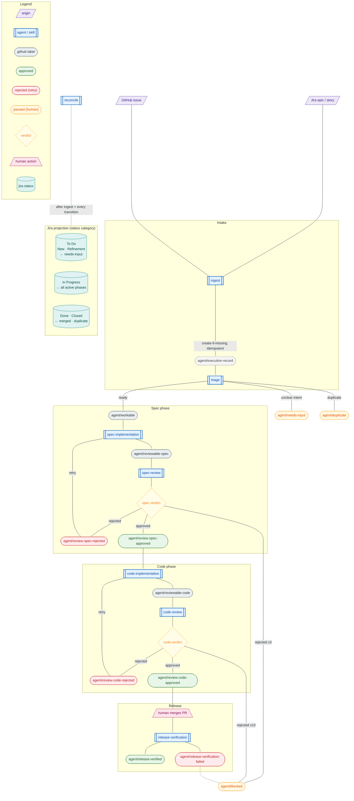

# .hypershell/

This directory configures HyperShell agent automation for this repository.
It is to HyperShell agents what `.github/` is to GitHub Actions: repo-local
automation that decorates the repo with agent capabilities without being part
of the core platform.

Automation is **declarative**. This directory is a Kustomize root. A server-side
import process (see `Repository.import_path` in
`specs/platform/data-model.spec.md`) builds a kustomization and reconciles the
rendered HyperShell ext-API resources into the API. The former imperative
`discover.sh` / `run.sh` script contract has been removed; an `AgentRuntime` with
a `selector` now expresses discovery declaratively.

These manifests carry **no explicit cluster**. The `Gateway` is fully
declarable: it states the *type* of placement it wants as capability-label
selectors (e.g. `network/public`, `provider/ibm`) rather than a `cluster_id`, and
the control plane resolves and assigns a matching `ManagedCluster` at provision
time. Agents reference that gateway by name and assume it provisions when applied
to a cluster whose capabilities match.

## Layout

```
.hypershell/
├── kustomization.yaml          # root import: the full fleet (base/platform + every agent)
├── base/                       # the basic agent (standalone, runnable)
│   ├── kustomization.yaml      # platform + agent.yaml
│   ├── agent.yaml              # one complete AgentRuntime graph (slim runtime)
│   └── platform/               # shared, reusable kinds referenced by name
│       ├── kustomization.yaml
│       ├── repository.yaml     # Repository (this repo) + credential reference
│       ├── gateway.yaml        # Gateway (agents-gateway) placed by capability selector
│       ├── sandbox-template.yaml # agent-runtime-slim + basic network policy
│       └── provider-specs.yaml # claude-inference, github-source-control
└── agents/<name>/              # agent instances (overlays on base/platform)
    ├── agent.yaml              # AgentRuntime (selector) + SecretSources + ProviderBindings + InferenceRoute
    ├── kustomization.yaml      # base/platform + agent.yaml
    └── SKILL.md                # the agent's workflow prompt (unchanged)
```

- **`base/`** is one complete basic agent with the slim runtime and the basic
  network policy, plus all the declared platform kinds. It is directly runnable:
  `hsctl apply -k .hypershell/base`.
- **`agents/<name>/`** are the real agent instances. Each is an overlay that
  reuses the shared `base/platform` kinds (by name) and adds its own
  `AgentRuntime` (with `selector`) and owned ext-API objects. None of them
  contain cluster information. Exceptions: `agents/ingest/` and
  `agents/reconcile/` are orchestration responsibilities (see "Orchestration
  responsibilities" below); they carry a `SKILL.md` only, with no `agent.yaml`,
  because `execute-sdlc` invokes them inline rather than the coordinator
  scheduling them.

`SKILL.md` holds each agent's workflow prompt and is still authored by hand; it
has no declarative equivalent and is loaded by the coordinator at run time.

## Defined Agents

Each `AgentRuntime` carries a `selector` (a list of labels). On each `cron` tick
the coordinator queries the referenced `Repository` for items carrying **any**
selector label and fans out one sandbox per match. `update-openshell` has no
selector: it is purely scheduled.

**`agent/allowed` gates the whole funnel, not only triage.** It is the human
authorization gate, separate from the `agent/scope/*` run selector: scope selects
an item for a run, `agent/allowed` authorizes the funnel to act on it. The gate is
load-bearing across every write-performing step - intake, reconciliation, and work
selection - not only triage. A scoped but un-authorized item is inert: `ingest`
creates no Jira epic, GitHub execution record, or canonical link for it;
`reconcile` skips it without writing (reported skipped, not failed); and
`execute-sdlc` work selection never selects it. Authorization is a human act: NO
agent applies `agent/allowed`, so an execution record `ingest` creates starts
un-authorized (carrying only `agent/execution-record` and its scope label) and
stays inert until a human grants the gate by hand. See
`specs/standards/sdlc/jira-github-sync.spec.md` (`Authorization Gate Is
Load-Bearing`).

| Agent | Selector label(s) | Output label(s) |
|-------|-------------------|-----------------|
| `triage` | `agent/allowed` | `agent/workable`, `agent/needs-input`, `agent/duplicate` |
| `spec-implementation` | `agent/workable`, `agent/review-spec-rejected` | `agent/reviewable-spec` |
| `spec-review` | `agent/reviewable-spec` | `agent/review-spec-approved`, `agent/review-spec-rejected` |
| `code-implementation` | `agent/review-spec-approved` | `agent/reviewable-code` |
| `code-review` | `agent/reviewable-code` | `agent/review-code-approved`, `agent/review-code-rejected` |
| `review-response` | `agent/needs-review-response` | re-queues spec/code review |
| `release-verification` | `agent/release-pending` | `agent/release-verified`, `agent/release-verification-failed` |
| `update-openshell` | (scheduled, no selector) | opens an update PR (`agent/reviewable-code`) |

### Orchestration responsibilities

Two responsibilities under `agents/` are not cron-scheduled fleet members: they
are invoked by the `execute-sdlc` orchestrator (which is itself a `SKILL.md` with
no `AgentRuntime`). They have a `SKILL.md` only, no `agent.yaml`/selector, because
they run inside a funnel pass rather than on their own cron tick:

| Responsibility | Invoked by | Purpose |
|----------------|------------|---------|
| `ingest` | `execute-sdlc` Step 0 | Origin-agnostic intake: ensure every in-scope, `agent/allowed`-authorized work item has a linked GitHub execution record (create-if-missing, idempotent). Never self-authorizes a created record. |
| `reconcile` | `execute-sdlc` Step 0 (newly ingested record) and Step 3 (after each phase transition) | Bidirectional Jira <-> GitHub sync under a per-field authority rule: derived Jira status, artifact remote links, attributed phase comments, credit preservation. Skips (no write) any record lacking `agent/allowed`. |

`ingest` marks each execution record with the `agent/execution-record` label.
This label is the canonical-link marker: combined with the exact Jira key in the
issue body, it is the idempotency key that lets `ingest` reuse (never duplicate)
an execution record. It is not a phase label and does not appear in the phase
state machine below.

The terminal `Done` projection happens when `reconcile` runs AFTER the human
merges the pull request: `execute-sdlc` ends at `agent/review-code-approved`
(approved, not merged, projecting In Review), and its handoff asks the human to
merge and then re-run `reconcile`, which is idempotent and detects the merge.

These realize `specs/standards/sdlc/jira-github-sync.spec.md`.

### Label state machine

Shapes encode node type (see the Legend). For labels, color encodes outcome: green = approved or success, red = rejected and retried, amber = paused for a human. `reconcile` runs after `ingest` and after every phase transition to project the GitHub phase onto a Jira status category.



## Reference resolution

Foreign keys in these manifests reference other declared resources **by name**
(e.g. `repository_id: openshift-online/hypershell`, `sandbox_template_id: agent-runtime-slim`,
`provider_spec_id: claude-inference`, `workspace_id: <runtime-name>`). The import
process resolves each name to the concrete resource ID at reconcile time.
`workspace_id` references the runtime's own name because the control plane
creates exactly one `AgentWorkspace` per `AgentRuntime`; the importer maps the
runtime to its workspace.

## Placeholders

Credential and project values that are environment-specific are written as
`REPLACE_WITH_*` and must be supplied before the manifests are usable in a given
environment:

| Placeholder | Where | Supply via |
|-------------|-------|------------|
| `REPLACE_WITH_GITHUB_APP_ID` | github `ProviderBinding.refresh_strategy` | patch or pre-provision |

Inference uses a URL + token provider: the `claude-inference` ProviderSpec points
at `https://api.anthropic.com` and the token is supplied by each agent's
`*-inference-key` SecretSource (`purpose: api-key`). The sandbox reaches
`api.anthropic.com` directly; the supervisor egress proxy injects the token, so
no credential enters the sandbox and there is no `inference.local` host.

The GitHub App credential `SecretSource` named `github-app-credentials`
(referenced by `base/platform/repository.yaml`) is a platform-provisioned secret
and is not declared here.

## Applying

```sh
# The basic agent (standalone reference):
hsctl apply -k .hypershell/base

# The full fleet (what the import process does):
hsctl apply -k .hypershell

# A single agent instance:
hsctl apply -k .hypershell/agents/triage

# Preview without writing:
hsctl apply -k .hypershell --dry-run
```

## Agent runtime images

The image definitions live in [`components/agents`](../components/agents/README.md).
These manifests use `agent-runtime-slim`, which provides native Claude Code,
Atlassian CLI, GitHub CLI, hsctl, Python and shell utilities. The harness
resolves its image digest from the selected release bundle, clones the trusted
repository into `/sandbox/hypershell`, and injects per-run credentials. Agent
scripts and credentials are not embedded in these images.
