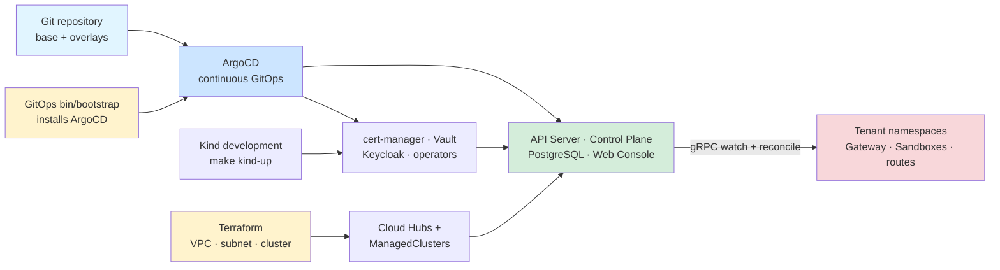

# Provisioning and delivery

Terraform provisions cloud infrastructure; the GitOps repository's `bin/bootstrap` installs ArgoCD on each cluster; ArgoCD continuously reconciles Git-managed cluster state; the control plane handles tenant resources.

Authoritative source: specs/platform/global-architecture.spec.md; specs/platform/local-development.spec.md

### Infrastructure and application delivery responsibilities are separated by lifecycle and scope.

