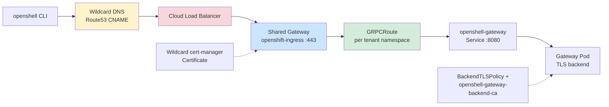
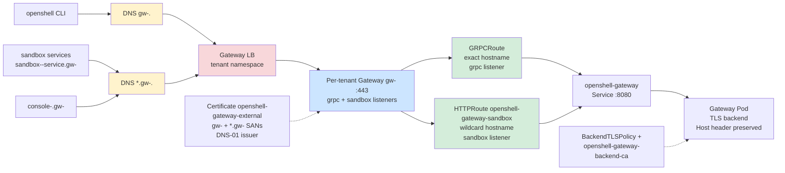
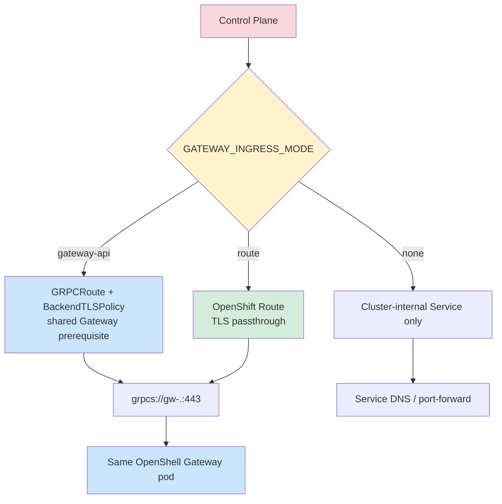

# Gateway ingress

External gRPC exposure is configuration-driven. AWS uses the shared Gateway API path; environments without a functional Gateway API use OpenShift Route passthrough.

Authoritative source: specs/platform/global-architecture.spec.md; specs/platform/openshell-gateway-routing.spec.md

### Reference gateway-api mode: one shared Gateway and load balancer serve many tenant GRPCRoutes.

### Per-gateway opt-in (`route.certificate`): the opted-in gateway gets its own Gateway, wildcard certificate, and wildcard DNS.

A Gateway provisioned with `route: { certificate: {} }` does not attach to the shared Gateway. The control plane creates, in the tenant namespace, a per-tenant Gateway `gw-<ns>` with two port-443 listeners (`grpc` exact hostname, `sandbox` wildcard hostname), a single cert-manager Certificate covering both `gw-<ns>.<base-domain>` and `*.gw-<ns>.<base-domain>`, and a wildcard-hostname HTTPRoute that forwards sandbox-service traffic to the gateway Service on port 8080. Both DNS records are published via the per-tenant Gateway's `external-dns.kubernetes.io/hostname` infrastructure annotation (manual records are the fallback without external-dns). The per-gateway console rides the `sandbox` listener at `console-<ns>.gw-<ns>.<base-domain>`. See specs/platform/openshell-gateway-routing.spec.md (Per-Gateway Dedicated Route and Certificate).

### Environment-adaptive routing: both modes converge on the same tenant workload and route address contract.

