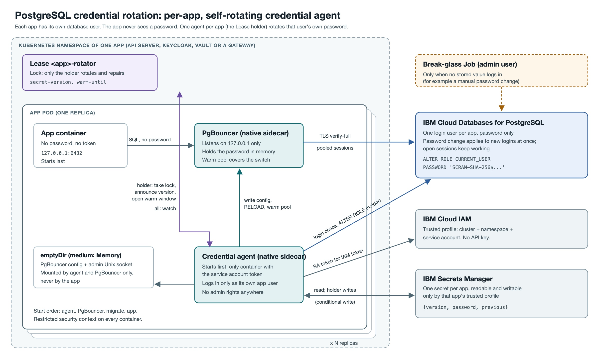
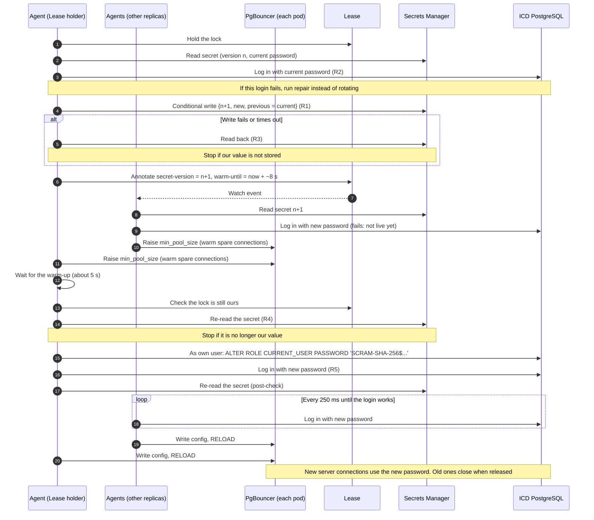

# Investigation: PostgreSQL credential rotation on IBM Cloud and AWS

**Date:** 2026-11-16
**Status:** Investigation and design proposal. A proof of concept (PoC) was
built and tested on Kubernetes. No product code was changed.
**Question:** Can the apps connect to their PostgreSQL databases without
holding a long-lived password, and can we rotate database passwords without
outages?

---

## Scope and goals

### Scope

| Area | In scope |
|---|---|
| Clouds | IBM Cloud: IBM Cloud Databases (ICD) for PostgreSQL. AWS: RDS / Aurora for PostgreSQL. Kind is used for development and tests only |
| Apps | Vault, Keycloak, the HyperShell API server, and the OpenShell gateways |
| Credentials | The PostgreSQL login of each app. Admin logins are covered only as far as break-glass needs them |

### Goals

1. **Work on IBM and AWS with one design.** The pod layout, the agent and
   the rotation rules are the same on both clouds. Only the agent's
   password source changes (section 2.6).
2. **Cover all four apps.** Vault, Keycloak, the API server and the gateways
   use the same sidecars. Per-app differences are limited to how the
   sidecars are added (section 7.4).
3. **Avoid application restarts.** A password change must never require
   restarting an app pod. That rules out designs that only work by rolling
   pods, which would mean unsealing Vault again and Argo CD drift on every
   rotation.
4. **Avoid creating two users per app.** Each app keeps exactly one
   database login user. No A/B user pairs, no shared owner role, no move
   of table ownership, and no drain step. We accept a few seconds of
   possible errors during a switch in exchange for this simplicity. The PoC
   measured 0 errors.

### Non-goals

- Passwordless PostgreSQL logins on ICD: ICD does not support them.
- Rotating the cloud providers' own admin or master users. IBM service keys
  and the RDS-managed master password have their own rotation.

---

## Verdict

ICD cannot remove passwords: it only accepts username and password logins.
But we can take passwords out of the apps and rotate them safely:

1. **Each app pod gets two sidecars:** PgBouncer and a small credential
   agent. The app connects to PgBouncer on `127.0.0.1` with no password.
2. **The agent fetches the password through IBM Cloud IAM.** It uses the pod's
   service account through an IAM trusted profile, and reads the password
   from IBM Secrets Manager. No API key and no Kubernetes Secret holds the
   password.
3. **The agent rotates its own app's database user.** One agent per app holds
   a Kubernetes Lease and runs `ALTER ROLE CURRENT_USER`. No app pod has
   admin rights on the database.
4. **PgBouncer picks up a new password with `RELOAD`.** The app never
   restarts. A short warm-up of spare connections covers the switch.
5. **Every failure leaves a state that repairs itself.** The rule is: the
   database password is always the current or the previous value stored in
   Secrets Manager. The admin user is kept only for a break-glass Job.

On AWS the same sidecars and rules apply. The agent reads from AWS Secrets
Manager through the pod's IAM role instead (section 2.6).

The PoC ran 25 failure cases on a 3-replica app with 0 failed queries.

The diagram shows IBM Cloud. On AWS, IBM Cloud IAM becomes an IAM role
for the pod's service account, IBM Secrets Manager becomes AWS Secrets
Manager, and ICD becomes RDS.

---

## 1. The problem

### 1.1 What ICD allows

| Fact | Consequence |
|---|---|
| ICD logins use a username and password only | No IAM login and no client certificate login to PostgreSQL |
| IAM only controls ICD's management API | IAM can create users and change passwords through the API, but it never checks a PostgreSQL login |
| ICD's CA is for checking the server | Clients verify ICD with `verify-full`; the CA does not log anyone in |
| PostgreSQL gives each user one password | A password change applies to new logins at once. Open sessions keep working |

### 1.2 How the apps load their passwords today

None of the four apps picks up a new password without a restart. The table
shows IBM. On AWS the sources are AWS Secrets Manager through ESO (refresh
every 5 minutes), but the apps load the values the same way, so the result
is the same.

| App | Where the password comes from (IBM) | How the process gets it | Picks up a change? |
|---|---|---|---|
| API server | Terraform writes Secret `hypershell-db-app` | Files under `/secrets`, read once at startup by rh-trex-ai into a fixed connection string | No, restart needed |
| Gateways | Control plane writes `openshell-gateway-db-credentials` per gateway | `OPENSHELL_DB_URL` environment variable | No, restart needed |
| Vault | Secrets Manager through ESO (refresh every hour) | `PGPASSWORD` environment variable | No, restart needed |
| Keycloak | Secrets Manager through ESO (refresh every hour) | Environment variables set by the Keycloak operator | Yes: the operator restarts Keycloak when its Secret changes |

The gateway spec says so explicitly: requirement OSG-DBS-09 is "No Credential
Rotation" (`specs/platform/openshell-gateway-database.spec.md`). Platform
passwords are only changed by hand through Terraform.

### 1.3 Why a naive rotation breaks

If you change a user's password, every new connection fails until every pod
has the new value. With apps that read the password once, that means a
restart of every pod. A slow or stuck restart becomes an outage.

---

## 2. The chosen design

### 2.1 Components

| Component | Where it runs | What it does |
|---|---|---|
| App container | App pod | Connects to `127.0.0.1:6432` with no password. Never sees a token or a password |
| PgBouncer | Native sidecar in each app pod | Holds the database password in memory. Logs in to ICD with TLS `verify-full`. Reloads its config without a restart |
| Credential agent | Native sidecar in each app pod | Gets an IAM token, reads the secret, checks new passwords, writes PgBouncer's config and runs `RELOAD`. The Lease holder also rotates and repairs |
| Lease `<app>-rotator` | App namespace | Lock: only one agent per app rotates. Its annotations announce the new version number and the warm-up window, never the password |
| IBM Cloud IAM trusted profile | IBM Cloud | Maps cluster + namespace + service account to an IAM identity. No API key |
| IBM Secrets Manager | IBM Cloud | One secret per app: `{version, password, previous}`. Only that app's trusted profile can read or write it |
| ICD | IBM Cloud | One login user per app |
| Break-glass Job | Platform namespace | Uses the admin user to reset a password, only when no stored value logs in |

### 2.2 Pod layout and security rules

The agent and PgBouncer are native sidecars (init containers with
`restartPolicy: Always`). They start in order: agent, PgBouncer, then the
app's own init containers (such as the API server's `migrate`), then the app.

| Rule | How |
|---|---|
| Only this pod can reach PgBouncer | `listen_addr = 127.0.0.1`. Listening on `0.0.0.0` would let any pod connect with no password |
| Only the agent drives PgBouncer | The admin console is a Unix socket in an emptyDir that only the agent and PgBouncer mount |
| The app cannot read the password | PgBouncer's config lives in an emptyDir with `medium: Memory`, not mounted into the app |
| Only the agent has an identity | `automountServiceAccountToken: false`. The projected token is mounted into the agent only. Each app has its own service account |
| No plaintext password on the server | The agent sends `ALTER ROLE CURRENT_USER PASSWORD 'SCRAM-SHA-256$...'`, a verifier computed in the agent |
| No admin in app pods | The agent logs in only as its own user. PostgreSQL lets any user change its own password |
| Small Kubernetes rights | The agent's Role allows only Leases (`get list watch create update`) in its own namespace |
| Hardened containers | Non-root, drop `ALL`, read-only root filesystem, `seccompProfile: RuntimeDefault` |

### 2.3 The safety rule

> **The database password is always either the current or the previous value
> in Secrets Manager.**

If this holds, a restarted pod can always log in, and repair can always fix
the database with the app's own user. Five rules keep it true:

| Rule | What it means |
|---|---|
| R1 | One write stores `{version, password, previous}` together. We do not depend on Secrets Manager's own version history |
| R2 | Start a rotation only if the current value logs in. Otherwise run repair first |
| R3 | A write that fails or times out has an unknown result. Read the secret back to find out |
| R4 | Re-read the secret just before `ALTER ROLE`. Stop if it is no longer the value this agent wrote |
| R5 | After `ALTER ROLE`, log in with the new value. The login decides whether the change happened, whatever `ALTER ROLE` returned |

Two more guards protect against a paused, stale Lease holder:

- **Conditional write.** The write to Secrets Manager carries the revision
  the agent read (`If-Match`), so a stale write is rejected.
- **Post-check.** After `ALTER ROLE`, read the secret again. If it changed in
  the meantime, set the current value straight away.

### 2.4 Warming the pool

PostgreSQL keeps open sessions alive when a password changes. So spare
server connections that PgBouncer opened with the old password keep working
during the switch.

- Right before `ALTER ROLE`, the Lease holder opens a short warm window
  (annotation `warm-until`, about 8 seconds).
- Inside the window, every agent raises PgBouncer's `min_pool_size` by a few
  connections.
- Once the new password logs in, the agent rewrites the config and runs
  `RELOAD`, which also resets `min_pool_size`.
- If the window ends and the new password still fails, the agent gives the
  spare connections back. It never holds them longer than 15 seconds.

### 2.5 Repair, startup and break-glass

- **Repair** runs on the Lease holder every few minutes, and once when an
  agent takes the Lease. If the current value does not log in, it logs in
  with the previous value and runs `ALTER ROLE` to the current one.
- **Startup.** An agent uses the newest stored value that logs in: current
  first, then previous. If neither works, the pod does not start and the
  agent reports `STUCK`.
- **Break-glass.** If no stored value logs in (for example, someone changed
  the password by hand), a Job using the admin user sets the database to the
  current stored value.

### 2.6 IBM and AWS

The pod layout, PgBouncer, the Lease and rules R1-R5 are the same on both
clouds. Only the agent's identity and password store change.

| | IBM Cloud | AWS |
|---|---|---|
| Database | ICD for PostgreSQL | RDS / Aurora for PostgreSQL |
| Pod identity | IAM trusted profile matching cluster, namespace and service account | IAM role assumed with the pod's service account token (STS web identity) |
| Password store | IBM Secrets Manager, one secret per app | AWS Secrets Manager, one secret per app |
| Secret format | `{version, password, previous}` | Same |
| Access rule | Only the app's trusted profile can read and write its secret | Only the app's IAM role can read and write its secret |
| Conditional write | To be checked (section 8) | To be checked (section 8) |

**Option on AWS: RDS IAM authentication.** RDS can accept a short-lived IAM
token (15 minutes) instead of a password. The agent would request a token for
its own user and give it to PgBouncer as the password, then refresh it and
run `RELOAD` before it expires. Tokens are checked only at login, so open
sessions keep working. This removes stored passwords and rotation on AWS
entirely, with the same sidecars and still one user per app. It is a later
step: it makes the two clouds behave differently, and RDS limits how many
new connections per second can use IAM authentication.

---

## 3. Rotation flow

The Lease holder is one of the app's replicas. The other replicas follow the
same steps as the holder for checking and reloading, but never write.

The other replicas learn about a rotation from the Lease watch, within a few
milliseconds. They also read Secrets Manager every 5 minutes as a backup.

---

## 4. Failure handling

No shared transaction exists between Secrets Manager and PostgreSQL. Instead,
every state in between is safe, and repair or the next rotation finishes the
job.

| Failure | State afterwards | How it is fixed |
|---|---|---|
| Secrets Manager write fails | Nothing changed | R3 read-back shows the old value. Retry later |
| Write times out but was stored | New value stored, database not changed | R3 read-back finds it. The rotation carries on |
| Holder crashes between the write and `ALTER ROLE` | Secrets Manager has `new`, database has `old` (= previous) | Agents keep the old password because their login check fails. The next holder runs repair |
| `ALTER ROLE` fails | Same as above | Repair |
| `ALTER ROLE` works but its reply is lost | Database has `new` | The R5 login shows it worked |
| Second rotation while the first is not live | Would push the live password out of `previous` | R2 refuses to start it and runs repair |
| Stale holder wakes up after the Lease moved | Two writers | Lease check, R4 re-read and the conditional write stop it. The post-check fixes the last small window |
| A replica or every pod restarts mid-rotation | Pods start on the previous value | Repair makes the current value live |
| Password changed outside the system | No stored value logs in | Repair reports `STUCK`. The break-glass Job fixes it |

An agent that keeps seeing a version that does not log in slows its checks
from 250 ms to 5 s after a minute, and raises an alert. The old password
keeps working the whole time.

---

## 5. Proof of concept results

The PoC lives outside this repository, in
`~/work/experiments/pgbouncer-rotation-poc` (commits `5d9f8bb` to `e76bc93`).
It stands in for IAM and Secrets Manager with a fake service that checks the
pod's token and supports conditional writes.

### 5.1 First version (docker-compose, one app instance)

- **`server_login_retry` matters.** With the default of 15 seconds, a
  3-second gap between `ALTER ROLE` and `RELOAD` became 11 seconds of errors.
  At 1 second, the errors match the gap.
- **Warming removes the gap.** Raising `min_pool_size` before `ALTER ROLE`
  gave 0 errors, at a cost of about 3 seconds per rotation.
- **`RELOAD` resets values changed with `SET`.** The reload that switches the
  password also undoes the warm-up.
- **Check before reload.** A secret that arrived 3 seconds before the
  database had it caused 55 failed queries without a check, and 0 with a
  direct login check before `RELOAD`. The check costs about 4 ms.

### 5.2 Kubernetes version (Kind 1.36, 2 apps, 3 replicas each)

| Case | Time until all replicas are live | Failed queries, app A |
|---|---|---|
| Normal rotation (3 times) | 1.3 s | 0 |
| Secrets Manager write fails, or times out with or without storing | 1.3 s or no change | 0 |
| `ALTER ROLE` fails, or its reply is lost | 1.2 to 19.8 s | 0 |
| Holder crashes, or its pod is deleted, mid-rotation | 26 to 36 s (repair interval) | 0 |
| A replica, or every pod, restarts mid-rotation | 0.2 s | 0 |
| Two rotations where the first `ALTER ROLE` fails | 9.9 to 26.4 s | 0 |
| Stale holder (six variants) | 0.2 to 4.5 s | 0 |
| Password changed outside the system | Fixed by break-glass in 3 s | 0 |

Other findings:

- **Isolation holds.** App A's user cannot change app B's password
  (`permission denied`), and app A cannot read or write app B's secret.
- **The conditional write is needed.** Without it, a holder paused before
  its write overwrote a newer secret, and the database matched neither
  stored value.
- **Connection budget.** One run hit `max_connections` and app B (the
  control) got `too many clients` errors. The main cause was pool sizing:
  6 replicas x 50 connections could reach 300, against a limit of 100.
  Warming for as long as a version was pending made it worse, which is why
  warming now uses a short window.
- **Lease watch instead of polling.** A non-holder replica made 2 reads of
  Secrets Manager in about 7 minutes, instead of about 30 a minute when
  polling.
- **Failed logins.** Each replica tries the pending password every 250 ms,
  so a rotation causes 12 to 16 failed logins per replica in the database
  log.

---

## 6. Alternatives considered

| Alternative | Why we did not choose it |
|---|---|
| **Keep fixed passwords (today)** | Passwords sit in Kubernetes Secrets and Terraform state, and changing one means restarting every pod |
| **IAM login to PostgreSQL** | ICD does not support it. IAM only covers the management API |
| **Client certificate login** | ICD does not support it. Its CA only lets clients check the server |
| **Two users per app (A/B) with pod restarts** | Breaks goals 3 and 4. Works with no outage, but every rotation restarts every pod: Vault must be unsealed again and Argo CD sees drift |
| **Two users per app behind PgBouncer** | Breaks goal 4. Removes the last small gap, but needs an owner role, a one-time move of table ownership and a drain step. Not worth it: the PoC measured 0 errors with one user |
| **Live reload inside the apps** (for example, rh-trex-ai reading the password file per connection) | Breaks goals 2 and 3. Only fixes the API server. Gateways, Vault and Keycloak would still need restarts, and the password still sits in a Secret |
| **IBM's own PgBouncer setup (`auth_query`)** | Breaks goal 3. Apps still send their own password to PgBouncer, so they still need a restart when it changes |
| **Vault database secrets engine** | Vault cannot rotate the password of its own storage database. Its static roles change one password in place, which brings back the outage gap. It would also give the gateway Vault rights over platform databases |
| **Secrets Manager's built-in rotation of ICD service credentials** | Breaks goal 4 in a worse way: it creates a new database user on every rotation. Each new user must then be granted access to the app's tables, which needs SQL that Secrets Manager will not run |
| **IAM changes ICD user passwords directly through the ICD API** | Breaks goal 1: IBM only. It only works for users ICD manages; ours are created with SQL. IBM's API lists say it needs the Administrator role on the deployment. Moving users to the ICD API adds them to `ibm-cloud-base-user`, which gives them more rights than needed |
| **A central rotator with the admin login** | Any component holding the admin login can change every user's password on the server. Self-rotation keeps each pod limited to its own user. The admin login stays only in the break-glass Job |
| **Agents without a lock** | Several replicas would rotate at once and overwrite each other |
| **One shared PgBouncer per cluster** | Fewer connections, but a single point of failure and harder isolation between tenant gateways |
| **A custom PostgreSQL proxy** | Re-implements what PgBouncer already does: login handshakes, TLS, pooling, cancel requests |
| **Polling Secrets Manager often** | About 30 reads per replica per minute. Watching the Lease gives the same speed at almost no cost |
| **Warming for as long as a new version is pending** | Held spare connections for 20 to 30 s after a failed `ALTER ROLE`, adding to connection pressure. Replaced by the short warm window |
| **Warming only on a fixed schedule** | Needs every agent to agree on the time. The Lease annotation gives the same result without a schedule |

---

## 7. What production needs

### 7.1 Platform

- **Native sidecars** need Kubernetes 1.29, which is OpenShift 4.16 or later.
  Check every cluster's version.
- **Trusted profiles for pods on ROKS.** IBM documents them for its
  Kubernetes service. We assume OpenShift on IBM Cloud works the same way;
  test this first, because the design depends on it.
- **Network access** from the agent to IAM and the Secrets Manager private
  endpoint. Check NetworkPolicy and egress rules.
- **A conditional write in IBM Secrets Manager** (a version check or lock).
  If it has none, use a Lease-based check right before the write instead.

### 7.2 PgBouncer settings

- `server_login_retry` at 1 to 2 seconds.
- `server_lifetime` must never be 0: that means "use each connection once".
- `pool_mode = session` to start with. The API server needs it for `LISTEN`.
- One `application_name` per pod, so `pg_stat_activity` shows each pod.
- TLS to ICD with `verify-full` and the ICD CA, delivered as a ConfigMap.

### 7.3 Connection budget

For each database server, add up over every app that uses it:

    replicas x default_pool_size + replicas x warm-up spares

The total must stay below `max_connections` minus reserved slots. If it
cannot, lower `default_pool_size` or set `max_db_connections`. On ICD,
`max_connections` depends on the plan's memory.

### 7.4 Changes per app

| App | Change | Watch out for |
|---|---|---|
| Vault | Sidecars through the Helm chart's extra containers. `connection_url` points at localhost | Gains the most: no more unseal steps for rotation |
| Keycloak | Sidecars through `unsupported.podTemplate` in the Keycloak CR. DB URL points at localhost | The operator may still require `usernameSecret` and `passwordSecret`; give it placeholders |
| API server | Point the DB host and port files at `localhost:6432` with `sslmode=disable` on localhost | rh-trex-ai may still require a password file. Check it retries a failed query cleanly |
| Gateways | Needs a change to the OpenShell Helm chart, and one trusted profile and secret per gateway | Tenant sandboxes share the namespace: they must not get the agent's service account |

### 7.5 Monitoring

- The agent exposes: last successful fetch, live credential version, reload
  count, failures, and PgBouncer's pool numbers.
- Alerts: a new version not live after a minute, `STUCK`, repeated fetch
  failures, login failures at PgBouncer.
- Activity Tracker records each IAM token exchange.
- Check whether ICD alerts on, or locks out, users after many failed logins.

### 7.6 Project work

1. Write a spec for credential rotation, and replace OSG-DBS-09.
2. Build the PgBouncer and agent images through Konflux. Register both in CI
   with `/maintain-ci`.
3. Add an end-to-end rotation test in Kind, based on the PoC.
4. Roll out in this order: Vault and Keycloak, then the API server, then
   gateways.
5. Write a runbook for IAM outages. Running pods keep working; new pods
   cannot start, so avoid draining nodes while IAM is down.

---

## 8. Open questions

- Do trusted profiles work for pods on ROKS?
- Does ICD let a user change its own password with `ALTER ROLE CURRENT_USER`?
  Plain PostgreSQL does; the PoC used plain PostgreSQL.
- Do IBM Secrets Manager and AWS Secrets Manager support conditional
  writes (a version check or lock)?
- Which AWS clusters can assume an IAM role from a pod's service account
  token, and with which setup?
- How does ICD react to repeated failed logins?
- Do the hub overlays run more than one replica of the API server or
  Keycloak? Base manifests use one.

---

## Sources

- [IBM Cloud Databases for PostgreSQL: user management](https://cloud.ibm.com/docs/databases-for-postgresql?topic=databases-for-postgresql-user-management)
- [IBM Cloud Databases for PostgreSQL: IAM](https://cloud.ibm.com/docs/databases-for-postgresql?topic=databases-for-postgresql-iam)
- [IBM Cloud Databases for PostgreSQL: PgBouncer](https://cloud.ibm.com/docs/databases-for-postgresql?topic=databases-for-postgresql-pgbouncer)
- [PgBouncer configuration](https://www.pgbouncer.org/config.html)
- [PgBouncer usage](https://www.pgbouncer.org/usage.html)
- [IBM: Turn your container into a trusted cloud identity](https://www.ibm.com/think/insights/turn-your-container-into-a-trusted-cloud-identity)
- PoC: `~/work/experiments/pgbouncer-rotation-poc`, `README.md` and
  `k8s/README.md`
