# Data Model

**Date:** 2026-08-03
**Status:** Active

## Overview

The HyperShell API server provides a control plane for deploying and managing distributed API gateways across multiple Kubernetes clusters and cloud providers.

Gateways and clusters are **top-level resources**. There is no organizational grouping layer: all gateways belong to the same platform, and tenancy is enforced by RBAC (platform-level `gateway:creator`/`platform:admin` and per-gateway `gateway:owner` (full control incl. delete; grantable, one or more), `gateway:admin` (granted administrators; no delete), and `gateway:viewer`). See [`security/rbac-enforcement.spec.md`](../security/rbac-enforcement.spec.md) and [`gateway-access-management.spec.md`](gateway-access-management.spec.md).

Current model:

- **ManagedCluster** - a Kubernetes cluster whose control plane has registered into the platform (`oidc_subject`, `last_seen_at`; see [`managed-cluster-registration.spec.md`](./managed-cluster-registration.spec.md)). Its self-declared, namespaced `capabilities` set is the source of truth for placement, including the single-valued `gateway-version` namespace that advertises the gateway version the control plane provisions onto new gateways. It also tracks API server URL and a kubeconfig secret reference, which are informational: no component consumes `kubeconfig_secret`, because each control plane reconciles its own cluster with in-cluster credentials.
- **Gateway** - an API gateway instance deployed onto a cluster within an API-assigned namespace. Its target cluster MAY be pinned explicitly through `cluster_id`, or left absent and late-bound to a matching `ManagedCluster` through a capability-label `placement` selector (see "Gateway Placement and Late Binding" below). Its PostgreSQL database is not modelled in the API: the control plane provisions one database and login role per gateway on the platform's gateway database server (see [`openshell-gateway-database.spec.md`](./openshell-gateway-database.spec.md)). Its only user-writable fields are `name` (create and update) and placement (create only); TLS mode, service type, external DNS, image, OIDC, routing, and lifecycle phase are all control-plane-managed and read-only to users and to the GitOps import (see "Requirement: Gateway Field Ownership and Write Policy", PLAT-DATA-23).
- **OpenShellGatewayServiceAccount** - a creator-bound automation identity for one Gateway. It stores an OpenShell role and non-secret Keycloak lifecycle metadata.
- **AgentRuntime** - a scheduled autonomous AI agent, referencing a ManagedCluster, Gateway, and SandboxTemplate, and optionally a Repository. Owns exactly one AgentWorkspace and one or more SecretSources. An optional `selector` (a list of labels) turns the runtime into a repository scanner: it queries the referenced Repository for items carrying any selected label and fans out one sandbox per match.
- **Repository** - a registered git repository (e.g. `https://github.com/openshift-online/hypershell`) paired with the provider credential HyperShell uses to reach it. The control-plane declarative-import reconciler discovers a `.hypershell/` directory in each registered Repository and renders the declarative HyperShell resources it finds into the API.
- **SandboxTemplate** - reusable OCI image + filesystem/network/process policy for agent worker sandboxes.
- **ProviderSpec** - reusable capability definition (inference, source_control, or knowledge) shared across ProviderBindings.
- **ProviderBinding** - wires a ProviderSpec into an AgentWorkspace with workspace-specific credential and refresh configuration.
- **InferenceRoute** - designates the active ProviderBinding and model alias for LLM inference within an AgentWorkspace. At most one per AgentWorkspace.
- **SecretSource** - abstract reference to durable credential material (GitHub App PEM, service-account key, gateway identity) in an external backend (Vault, AWS Secrets Manager, Kubernetes). Owned by AgentRuntime; purpose enum drives how the material is consumed (coordinator env for gateway-identity, OpenShell provider configuration for provider material).
- **CIProvider** - a registered CI OIDC issuer (GitHub Actions, GitLab CI/CD, Forgejo) whose workload tokens may be federated into gateway access. Platform-admin-scoped; referenced by many CITrusts; holds no secret.
- **CITrust** - a gateway owner's declaration that CI runs matching a subject claim predicate may exchange their OIDC token for a workspace-scoped OpenShell token on a Gateway they own. The self-service, secret-less way to enable CI on a gateway.

## Entity Relationship Diagram

```mermaid
erDiagram

    ManagedCluster {
        string ID PK
        string name
        string oidc_subject
        string[] capabilities
        string kubeconfig_secret
        string status
        string api_server_url
        time last_seen_at
        time created_at
        time updated_at
        time deleted_at
    }

    Gateway {
        string ID PK
        string name
        string cluster_id FK "nullable; late-bound by placement when absent"
        jsonb placement "capability-label selectors or local-kind mode; used when cluster_id is absent"
        string namespace
        string image
        string supervisor_image
        string[] server_dns_names
        jsonb oidc
        jsonb route
        text route_address
        jsonb credential_driver
        string external_dns
        string tls_mode
        string service_type
        string status
        string phase
        string gateway_version
        int generation
        int observed_generation
        time created_at
        time updated_at
        time deleted_at
    }

    OpenShellGatewayServiceAccount {
        string ID PK
        string gateway_id FK
        string name
        string description
        string credential_type
        string role
        string status
        string created_by_user_id FK
        string keycloak_client_id
        string keycloak_client_uuid
        string subject
        time expires_at
        time revoked_at
        string last_error
        time created_at
        time updated_at
        time deleted_at
    }

    AgentRuntime {
        string ID PK
        string name
        string cluster_id FK
        string gateway_id FK
        string sandbox_template_id FK
        string repository_id FK
        string[] selector
        string description
        string cron
        string coordinator_image
        string concurrency_policy
        int login_refresh_seconds
        jsonb parameters
        string status
        time created_at
        time updated_at
        time deleted_at
    }

    Repository {
        string ID PK
        string name
        string url
        string provider
        string secret_source_id FK "nullable; empty = anonymous public read"
        string default_branch
        string import_path
        string status
        time created_at
        time updated_at
        time deleted_at
    }


    AgentWorkspace {
        string ID PK
        string agent_runtime_id FK
        string gateway_id FK
        string name
        string status
        time created_at
        time updated_at
        time deleted_at
    }

    WorkspaceMembership {
        string ID PK
        string workspace_id FK
        string subject
        string role
        time created_at
        time updated_at
    }

    ProviderSpec {
        string ID PK
        string name
        string category
        jsonb capability
        jsonb profile
        string status
        time created_at
        time updated_at
        time deleted_at
    }

    ProviderBinding {
        string ID PK
        string workspace_id FK
        string provider_spec_id FK
        string secret_source_id FK
        string name
        jsonb refresh_strategy
        string status
        time created_at
        time updated_at
        time deleted_at
    }

    InferenceRoute {
        string ID PK
        string workspace_id FK
        string provider_binding_id FK
        string model
        time created_at
        time updated_at
    }

    SandboxTemplate {
        string ID PK
        string name
        string image
        string name_prefix
        jsonb policy
        string status
        time created_at
        time updated_at
        time deleted_at
    }

    SecretSource {
        string ID PK
        string agent_runtime_id FK
        string name
        string purpose
        string backend
        string path
        jsonb key_mappings
        time created_at
        time updated_at
        time deleted_at
    }

    CIProvider {
        string ID PK
        string name
        string forge
        string issuer
        string jwks_url
        string audience
        string status
        time created_at
        time updated_at
        time deleted_at
    }

    CITrust {
        string ID PK
        string ci_provider_id FK
        string gateway_id FK
        jsonb subject
        string role
        string status
        time created_at
        time updated_at
        time deleted_at
    }

    ManagedCluster ||--o{ Gateway : "hosts"
    Gateway ||--o{ OpenShellGatewayServiceAccount : "authorizes"
    ManagedCluster ||--o{ AgentRuntime : "runs"
    Gateway ||--o{ AgentRuntime : "connects_to"
    SandboxTemplate ||--o{ AgentRuntime : "sandbox_for"
    Repository ||--o{ AgentRuntime : "scanned_by"
    SecretSource |o--o{ Repository : "authenticates"
    AgentRuntime ||--|| AgentWorkspace : "owns"
    AgentRuntime ||--o{ SecretSource : "declares"
    Gateway ||--o{ AgentWorkspace : "hosts"
    AgentWorkspace ||--o{ WorkspaceMembership : "grants"
    AgentWorkspace ||--o{ ProviderBinding : "activates"
    AgentWorkspace ||--o| InferenceRoute : "routes_inference_via"
    ProviderSpec ||--o{ ProviderBinding : "bound_by"
    SecretSource ||--o{ ProviderBinding : "credentials_for"
    ProviderBinding ||--o| InferenceRoute : "routed_by"
    CIProvider ||--o{ CITrust : "federated_by"
    Gateway ||--o{ CITrust : "trusts_ci"
```



## Requirements

### Requirement: PLAT-DATA-01 -- Top-Level Resources

ManagedCluster and Gateway SHALL be top-level resources, scoped by no grouping other than the platform itself.

#### Scenario: PLAT-DATA-01.01 -- Create Gateway and Provision Its Workload

- GIVEN a valid `cluster_id` (or a `placement` selector)
- AND a `name`
- WHEN a POST request is made to `/api/hypershell/v1/gateways` with only `name` and
  placement (the user-writable allowlist, PLAT-DATA-23)
- THEN a new Gateway is created
- AND the control plane reconciler provisions the gateway workload from the
  control-plane-managed `image`/`supervisor_image` (the `GATEWAY_IMAGE`/
  `GATEWAY_SUPERVISOR_IMAGE` defaults, or an `image` the control plane set explicitly)

### Requirement: PLAT-DATA-02 -- Gateway Placement and Late Binding

A Gateway's target cluster SHALL be expressed in one of two ways, and `cluster_id`
SHALL be OPTIONAL on create:

- **Pinned.** When `cluster_id` is set, the Gateway is pinned to that cluster.
  This is the existing contract and is UNCHANGED: a set `cluster_id` (on create or
  on a `PATCH` that sets it) SHALL reference a registered `ManagedCluster` with a
  non-empty `oidc_subject`, and an empty-string `cluster_id` SHALL still be
  rejected (see [`managed-cluster-registration.spec.md`](./managed-cluster-registration.spec.md),
  "Requirement: Gateways Reference a Registered Cluster").
- **Late-bound by placement.** When `cluster_id` is ABSENT, the Gateway SHALL
  instead carry a `placement` selector that declares the TYPE of placement it
  wants as ManagedCluster capability-label selectors (for example
  `network/public`, `provider/ibm`) or a `local-kind` mode, exactly as the
  declarative `.hypershell` Gateway manifest uses. The API server SHALL resolve
  the selector to a concrete `ManagedCluster` and assign `cluster_id` server-side;
  this keeps the watch-stream caller binding authoritative, consistent with the
  server-side placement resolution used for `AgentRuntime`
  ([`control-plane.spec.md`](./control-plane.spec.md), "AgentRuntime effective
  cluster resolved server-side"). The selector vocabulary, validation, and
  random-selection-among-eligible-clusters rules are defined canonically in
  [`gateway-provision-placement.spec.md`](../web-console/gateway-provision-placement.spec.md)
  (WEB-PLC-01, WEB-PLC-07). The resolved `cluster_id` is exposed on read exactly as a pinned
  one.

A create request SHALL provide exactly one of the two: `cluster_id`, or a
`placement` selector. A request that supplies NEITHER SHALL be rejected, and a
request that supplies BOTH SHALL be rejected. `placement` SHALL be a desired-spec
field persisted on the Gateway (not merely request-scoped), because it is
re-evaluated for late binding after create.

**Late binding (no eligible cluster yet).** When a late-bound Gateway's selector
matches NO eligible `ManagedCluster`, the create SHALL still succeed: the Gateway
SHALL be persisted with an empty `cluster_id`, SHALL hold in the `Pending` phase
with a clear awaiting-placement `status`, and SHALL NOT be returned as an error.
The API server SHALL re-resolve placement for such unplaced Gateways when the
eligible-cluster set changes (for example when a matching `ManagedCluster`
registers or updates its capabilities), and SHALL assign `cluster_id` as soon as a
matching cluster appears. This is the same late-binding model used for agent
secrets (see [`agent-secret-late-binding.spec.md`](./agent-secret-late-binding.spec.md)):
a resource is declarable before the thing it binds to exists, and binds when that
thing appears. An unplaced Gateway (empty `cluster_id`) SHALL NOT be delivered to
any `cluster_id`-filtered watch or list stream, because no control plane is
responsible for it until it is placed.

#### Scenario: PLAT-DATA-02.01 -- Create a Gateway pinned to a cluster

- GIVEN a create request with a `cluster_id` that references a registered cluster
- WHEN the API server validates the request
- THEN it SHALL accept the request and persist the Gateway on that cluster
- AND the behavior SHALL be unchanged from the pre-existing pinned contract

#### Scenario: PLAT-DATA-02.02 -- Create a late-bound Gateway that resolves immediately

- GIVEN a create request with NO `cluster_id` and `placement.selector = ["network/public", "provider/ibm"]`
- AND at least one registered connected `ManagedCluster` carries both labels
- WHEN the API server resolves placement
- THEN it SHALL assign a matching cluster's `cluster_id` to the Gateway
- AND the Gateway SHALL proceed through its normal provisioning lifecycle

#### Scenario: PLAT-DATA-02.03 -- Create a late-bound Gateway that has no eligible cluster yet

- GIVEN a create request with NO `cluster_id` and a `placement.selector` that no registered cluster matches
- WHEN the API server processes the request
- THEN it SHALL create the Gateway with an empty `cluster_id` and `phase` `Pending`
- AND it SHALL NOT return an error
- AND the Gateway SHALL report an awaiting-placement `status`

#### Scenario: PLAT-DATA-02.04 -- Unplaced Gateway binds when a matching cluster appears

- GIVEN a `Pending` Gateway with an empty `cluster_id` whose `placement.selector` matched no cluster
- WHEN a `ManagedCluster` that carries every selected label registers
- THEN the API server SHALL assign that cluster's `cluster_id` to the Gateway
- AND the Gateway SHALL become eligible for reconciliation on that cluster

#### Scenario: PLAT-DATA-02.05 -- Create request with neither cluster_id nor placement is rejected

- GIVEN a create request with NO `cluster_id` and NO `placement`
- WHEN the API server validates the request
- THEN it SHALL reject the request with a validation error
- AND no Gateway SHALL be created

#### Scenario: PLAT-DATA-02.06 -- Declarative import creates a late-bound Gateway through placement

- GIVEN a `.hypershell` Gateway manifest that declares a `placement` selector and NO `cluster_id`
- WHEN the control-plane `RepositoryReconciler` imports it (see [`control-plane.spec.md`](./control-plane.spec.md), "Requirement: Import Writer Maps Gateway Placement")
- THEN the import writer SHALL send a create that carries the `placement` selector and no `cluster_id`
- AND the API server SHALL accept it under the exactly-one-of contract and late-bind it

### Requirement: PLAT-DATA-03 -- Gateway Namespace Ownership

The API server SHALL assign each Gateway an immutable Kubernetes namespace before persistence and before publishing its creation event. The namespace SHALL be `openshell-<id-hex-8>`, where `id-hex-8` is the lowercase hexadecimal encoding of 8 bytes from the Gateway KSUID's random payload, producing a 26-character namespace (e.g., `openshell-a1b2c3d4e5f67890`). This is stable, collision-safe for realistic gateway counts (~1 in 10^9 at 1M gateways), and a valid Kubernetes DNS label. Namespace SHALL be read-only in the REST contract and SHALL be absent from REST and gRPC create and update inputs.

#### Scenario: PLAT-DATA-03.01 -- Create Gateways Without a Namespace

- GIVEN two valid Gateway create requests that omit namespace
- WHEN the API server creates both Gateways
- THEN each response SHALL contain a non-empty namespace derived from its Gateway identifier
- AND the namespaces SHALL be distinct Kubernetes DNS labels
- AND each creation event SHALL contain the same namespace that was persisted

#### Scenario: PLAT-DATA-03.02 -- Namespace Cannot Be Selected or Updated

- GIVEN the REST and gRPC Gateway contracts
- WHEN a client constructs a create or update request
- THEN namespace SHALL NOT be available as an input field
- AND the API-assigned namespace SHALL remain available on Gateway responses and events

### Requirement: PLAT-DATA-04 -- Gateway Provisioning Fields

A Gateway SHALL include provisioning configuration fields that the control plane uses to deploy and configure the OpenShell gateway workload on a target cluster. These fields are **platform-managed (control-plane-only)** per "Requirement: Gateway Field Ownership and Write Policy" (PLAT-DATA-23): they are NOT part of the user or import create/update contract and are read-only to those callers. When `image` is unset the control-plane `GATEWAY_IMAGE`/`GATEWAY_SUPERVISOR_IMAGE` environment defaults apply (see [`openshell-gateway.spec.md`](./openshell-gateway.spec.md)); when the control plane sets `image` explicitly (for example the branch-build workflow in [`openshell-branch-build.spec.md`](./openshell-branch-build.spec.md)) the reconciler uses that reference directly. In every case the value is authored by the control plane or its configuration, never by a user create/`PATCH` or a `.hypershell` import manifest.

> **Relationship to database management fields:** The `image` field provides a direct image reference for the control plane reconciler. A Gateway carries no database configuration at all: the control plane provisions each gateway's database and login role on the platform's gateway database server using the admin credential Secret mounted into the controller (see [`openshell-gateway-database.spec.md`](./openshell-gateway-database.spec.md)).

All fields in the table below SHALL be present on the Gateway response schema and on the gRPC message so the control plane can write them over its internal `UpdateGateway` back-channel and every reader can observe them. They SHALL be marked `readOnly` on the REST contract and SHALL be rejected (not silently ignored) when a user or import caller sets or changes them, per PLAT-DATA-23. The `dev_build` and `dev_build_metadata` fields are defined by [`openshell-branch-build.spec.md`](./openshell-branch-build.spec.md).

`dev_build` and `dev_build_metadata` SHALL be platform-managed desired-spec fields
(control-plane-only, like `image`) because a change to either must be re-applied onto
workload labels and annotations through Helm values. Sandbox workload images are
selected per sandbox through OpenShell; they are not Gateway resource fields.

| Field | Type | Description |
|---|---|---|
| `image` | string | Gateway container image reference (e.g., `quay.io/opendatahub/odh-openshell-gateway:v0.1.5-rhaiv.3@sha256:...`) |
| `supervisor_image` | string | Supervisor sidecar container image (default supplied by `GATEWAY_SUPERVISOR_IMAGE` env var on the control-plane deployment; see `deploy/base/platform-resources/controller.yaml`) |
| `server_dns_names` | string[] | DNS names for TLS certificate SANs |
| `oidc` | JSONB | OIDC authentication config: `{issuer, audience, jwks_ttl, roles_claim, admin_role, user_role, scopes_claim}` |
| `route` | JSONB | Route exposure config for GRPCRoute provisioning: `{host}` |
| `route_address` | text | Read-only external address populated by the control plane (e.g., `grpcs://hostname:443`) |
| `gateway_version` | string | Read-only runtime version from the last successful gateway health response |
| `credential_driver` | JSONB | Credential storage driver config: `{type, kubernetes_secrets, vault}`. `type` is one of `vault`, `kubernetes-secrets`, `kek-db`. When omitted/null it resolves to `vault` (the default; convention-addressed per-cluster Vault, no sub-fields required). See [`openshell-gateway-credentials.spec.md`](./openshell-gateway-credentials.spec.md) |
| `workspace_mode` | text | How the OpenShell Kubernetes driver maps workspaces to namespaces: `shared`, `managed`, or `operator`. Platform-managed: the API server defaults it to `managed` at create and no caller may set or change it (the service funnel also enforces the vocabulary and immutability for control-plane writes). Null (pre-field Gateways) keeps the chart's `shared` default. See [`openshell-gateway.spec.md`](./openshell-gateway.spec.md), "OSG-CORE-18 -- Gateway Workspace Mode" |
| `dev_build` | boolean | Marks this Gateway as a dev/branch build (default: false). Control plane passes `hypershell.redhat.io/openshell-dev-build` via Helm `podLabels`. See [`openshell-branch-build.spec.md`](./openshell-branch-build.spec.md) |
| `dev_build_metadata` | JSONB | Dev build provenance: `{ref, sha, repo}`. Control plane passes these via Helm `podAnnotations`. See [`openshell-branch-build.spec.md`](./openshell-branch-build.spec.md) |

See [`openshell-gateway.spec.md`](./openshell-gateway.spec.md) and its sub-specs for full provisioning details.

### Requirement: PLAT-DATA-05 -- Gateway Deployment Lifecycle

A Gateway SHALL track its deployment lifecycle through the `phase` field. The `status` field SHALL reflect operational health.

#### Scenario: PLAT-DATA-05.01 -- Gateway Phase Progression
- GIVEN a Gateway in phase "Pending"
- WHEN the control plane provisions it on the target cluster
- THEN the phase SHALL transition to "Provisioning"
- AND upon successful deployment, to "Running"

### Requirement: PLAT-DATA-06 -- Gateway Generation Tracking

A Gateway SHALL carry a monotonic `generation` and an `observed_generation`
that together let the control plane distinguish a genuine desired-state change
from a redundant reconciliation event.

This requirement refines the convergence-latch guarantee of the control-plane
reconciliation contract
([`../standards/control-plane/reconciliation-contract.spec.md`](../standards/control-plane/reconciliation-contract.spec.md),
STD-RCON-06); it refines that contract and does not weaken it.

The API server SHALL increment `generation` whenever any field of the Gateway's
desired spec changes, including `name`, the platform-managed workload fields
`image`, `supervisor_image`, `server_dns_names`, `oidc`, `route`,
`credential_driver`, `external_dns`, `tls_mode`, `service_type`, `placement`, and
`cluster_id` (including the first time the API server assigns a `cluster_id` to a
late-bound Gateway). This holds regardless of WHICH writer made the change: a user
rename and a control-plane write of a platform-managed field both advance
`generation`; only the control plane may write the platform-managed fields
(PLAT-DATA-23). It SHALL NOT increment `generation` for changes to
control-plane-owned observed fields (`status`, `phase`, `route_address`,
`observed_generation`).

On creation, a Gateway SHALL initialize with `generation = 1` and
`observed_generation = 0`, so that a newly created Gateway is never spuriously
*converged* (`observed_generation < generation`) and always undergoes initial
provisioning.

`observed_generation` is control-plane-owned. The control plane SHALL set it to
the `generation` it last successfully applied to the cluster. A Gateway is
*converged* when `observed_generation == generation`.

The two fields differ in contract writability:

- `generation` SHALL be read-only across all client-facing REST and gRPC
  contracts (create, update, and patch); it is managed exclusively by the API
  server.
- `observed_generation` SHALL be read-only in the REST API and in all create
  requests, but SHALL be writable by the control plane through the gRPC
  `UpdateGatewayRequest` (the same back-channel by which the control plane
  reports `phase`, `status`, and `route_address`).

The API server SHALL treat `observed_generation` as a monotonic convergence
latch. On an `UpdateGatewayRequest` it SHALL accept a new `observed_generation`
only when `current observed_generation <= new <= generation`, and SHALL reject a
write that regresses the value below the current `observed_generation` or
exceeds the current `generation`. This prevents a stale or reordered update from
regressing the marker, and prevents any write from declaring a `generation`
converged before it has been applied - a false-converged state would otherwise
permanently mask drift.

#### Scenario: PLAT-DATA-06.01 -- New gateway starts unconverged
- GIVEN a valid Gateway create request
- WHEN the API server persists the Gateway
- THEN it SHALL set `generation = 1` and `observed_generation = 0`
- AND the Gateway SHALL NOT be *converged*, so the control plane provisions it

#### Scenario: PLAT-DATA-06.02 -- Spec change advances generation
- GIVEN a Gateway with `generation` N that has been applied
  (`observed_generation == N`)
- WHEN a desired-spec field changes (the control plane writes a platform-managed field
  such as `image`, or a user renames the gateway)
- THEN the API server SHALL increment `generation` to N+1
- AND `observed_generation` SHALL remain N until the control plane re-applies

#### Scenario: PLAT-DATA-06.03 -- Control plane writes observed_generation back
- GIVEN a Gateway with `generation` N+1 and `observed_generation` N
- WHEN the control plane successfully re-applies the manifests
- THEN it SHALL set `observed_generation` to N+1 via `UpdateGatewayRequest`
- AND the API server SHALL accept the write despite `observed_generation` being
  read-only to REST clients

#### Scenario: PLAT-DATA-06.04 -- Out-of-range observed_generation is rejected
- GIVEN a Gateway with `generation` N+1 and `observed_generation` N
- WHEN an `UpdateGatewayRequest` sets `observed_generation` below N or above N+1
- THEN the API server SHALL reject the write
- AND `observed_generation` SHALL remain N

#### Scenario: PLAT-DATA-06.05 -- Health update does not advance generation
- GIVEN a converged Gateway with `generation` N
- WHEN the control plane writes an observed `phase`/`status`/`route_address`
- THEN `generation` SHALL remain N
- AND the Gateway SHALL remain converged

### Requirement: PLAT-DATA-07 -- Monotonic Provisioning Conditions

`provisioning_conditions` is a user-facing progress ladder (see
[gateway-provisioning-progress.spec.md](gateway-provisioning-progress.spec.md)).
The control plane's provisioning path is not serialized end to end: a watch
re-seed on reconnect, or two controller pods overlapping during a rollout, can
replay earlier-stage conditions for the same `generation`. A last-writer-wins
persist would let a completed step flip back to an earlier state, so a Gateway
that has reached `phase` `Running` could transiently report an unfinished step.

The API server SHALL enforce provisioning-condition progress monotonically per
generation, under the same per-row lock that guards `generation`:

- When an update advances `generation` (a desired-spec change), the API server
  SHALL clear the prior generation's `provisioning_conditions` so the new
  provisioning cycle repopulates them from the beginning.
- When an update does not advance `generation`, the API server SHALL merge the
  incoming conditions onto the persisted ones so that, per condition type, the
  status only moves forward along `Pending` -> `InProgress` -> `Complete`. A
  `Failed` status SHALL always be accepted (an operator must see a real
  failure), and a condition SHALL be able to recover from `Failed`. A condition
  present only in the persisted document SHALL be retained so a narrower write
  cannot drop a step that already completed.

#### Scenario: PLAT-DATA-07.01 -- Redundant reconcile pass does not regress a completed step
- GIVEN a Gateway at `generation` N whose `GatewayHealthy` condition is `Complete`
- WHEN a redundant reconcile pass writes `GatewayHealthy` as `InProgress` at the
  same `generation`
- THEN the API server SHALL keep `GatewayHealthy` as `Complete`

#### Scenario: PLAT-DATA-07.02 -- Spec change restarts provisioning conditions
- GIVEN a converged Gateway at `generation` N with all conditions `Complete`
- WHEN a desired-spec field changes (a user rename or a control-plane write of a platform-managed field), advancing `generation` to N+1
- THEN the API server SHALL clear `provisioning_conditions`
- AND the control plane SHALL repopulate them for the new generation

#### Scenario: PLAT-DATA-07.03 -- Failure surfaces over a completed step
- GIVEN a Gateway at `generation` N whose `GatewayDeployed` condition is `Complete`
- WHEN a reconcile pass writes `GatewayDeployed` as `Failed` at the same
  `generation`
- THEN the API server SHALL record `GatewayDeployed` as `Failed`

### Requirement: PLAT-DATA-23 -- Gateway Field Ownership and Write Policy

The Gateway resource SHALL expose exactly ONE non-privileged-writable field after
create - `name` - plus placement at create. Every other Gateway field SHALL be
owned by the control plane and SHALL NOT be writable by an externally-authored
caller. This is a single, authoritative, default-deny write policy: it is the
chokepoint through which REST `PATCH`, gRPC `UpdateGateway`, gRPC `CreateGateway`,
REST create, and `hsctl apply` all funnel, so no write surface can diverge from it.

**Writer classes.** Because every writer calls the same gateway service write funnel
(`Replace` for update, `Create` for create), the authorization layer SHALL mark each
write request with one of three caller kinds, and the field policy SHALL key off that
marker (enforced for gRPC and REST in [`security/rbac-enforcement.spec.md`](../security/rbac-enforcement.spec.md),
"Requirement: Gateway Field Write Policy"):

| Writer class | How identified | May write |
|---|---|---|
| **User** | normal authenticated REST / gRPC / `hsctl apply` caller | the allowlist below |
| **Import** | control-plane gRPC request carrying the `x-hypershell-import-repository-id` metadata (the declarative `.hypershell` GitOps import; detected exactly as for import ownership) | the allowlist below - identical to a user |
| **Control plane** | control-plane gRPC request WITHOUT import metadata (the internal reconcile write-back path) | all fields (platform-managed and observed) |

The declarative `.hypershell` import is a NON-privileged writer: an import write
authenticates as the control plane but carries user-authored git content, so for
field-policy purposes it is treated exactly like a direct user and is held to the
same allowlist. Only the control plane's own internal reconcile logic (a
control-plane gRPC write WITHOUT import metadata) retains full write access.

**Allowlist (the ONLY non-privileged-writable fields).**

- UPDATE (REST `PATCH`, gRPC `UpdateGateway`): `name`.
- CREATE (REST create, gRPC `CreateGateway`): `name`, and exactly one of `placement`
  or `cluster_id` (per "Requirement: Gateway Placement and Late Binding").

For a User or Import caller, any field NOT in the allowlist SHALL be rejected when it
**differs from the stored value** (update) or is **set at all** (create), with the
rejected field named: `403 Forbidden` over REST, `PermissionDenied` over gRPC. For an
Import caller the rejection surfaces back through the `RepositoryReconciler` as a
failed import of that Gateway, so the git author sees the manifest is invalid.
Re-sending an unchanged platform-managed value SHALL be a no-op (not a rejection), so
`hsctl apply` and idempotent clients that resend the whole object still work; this
mirrors the existing "re-sending the stored `cluster_id` is not a reassignment"
pattern.

**Field ownership.** Every Gateway field SHALL be classified as exactly one of:

- **User-writable (allowlist):** `name` (create + update); `placement` / `cluster_id`
  (create only; `cluster_id` is otherwise control-plane-assigned by late binding and
  is NOT user-writable on update).
- **Platform-managed (control-plane-only desired workload spec):** `image`,
  `supervisor_image`, `server_dns_names`, `oidc`, `route`, `tls_mode`,
  `service_type`, `external_dns`, `credential_driver`, `workspace_mode`,
  `dev_build`, `dev_build_metadata`. These are purely platform-managed; no
  externally-authored input (direct user API or GitOps import) may declare them.
  The control plane sets them from its configuration and provisioning logic (for
  example the `GATEWAY_IMAGE` / `GATEWAY_SUPERVISOR_IMAGE` defaults, the per-gateway
  Keycloak OIDC client, and the derived ingress hostname). `workspace_mode` is
  additionally server-defaulted: the API server applies `managed` at create in the
  service funnel (see [`openshell-gateway.spec.md`](./openshell-gateway.spec.md),
  "OSG-CORE-18"), and its value semantics (vocabulary, immutability) are enforced
  there for every writer class, the control plane included.
- **Control-plane-observed (control-plane-only):** `status`, `phase`, `route_address`,
  `console_address`, `provisioning_conditions`, `gateway_version`,
  `observed_generation`, `active_sandbox_count`.
- **Server-owned (no caller writes):** `namespace`, `generation`, `repository_id`,
  and the timestamps.

**Default-deny guarantee.** Because the policy is an allowlist, a newly added Gateway
model field SHALL be control-plane-only automatically, with no per-field change. The
API server SHALL carry a field-census test that enumerates every Gateway model field
and asserts each is classified as user-writable (allowlisted) or control-plane-only;
the test SHALL FAIL when a field is added whose ownership is left undeclared, so the
default-deny rule is enforced in CI rather than by review alone.

This policy is consistent with the pre-existing read-only treatment of `oidc`
([`openshell-gateway-oidc.spec.md`](./openshell-gateway-oidc.spec.md),
"OSG-OIDC-01.02"), `generation`/`observed_generation` (PLAT-DATA-06),
`provisioning_conditions` (PLAT-DATA-07), `namespace` (PLAT-DATA-03),
`console_address`, and `active_sandbox_count`; it extends the same control-plane
ownership to the remaining workload fields.

#### Scenario: PLAT-DATA-23.01 -- User PATCH of a locked field is rejected

- GIVEN an existing Gateway and a `gateway:owner` user caller
- WHEN the user PATCHes a field outside the allowlist (for example `image`, `oidc`,
  `route`, `tls_mode`, `cluster_id`, `status`, or `phase`) to a value that differs
  from the stored one
- THEN the API server SHALL reject the request with `403 Forbidden` naming the field
- AND the stored Gateway SHALL be unchanged

#### Scenario: PLAT-DATA-23.02 -- User rename is accepted

- GIVEN an existing Gateway and a `gateway:owner` or `gateway:admin` caller
- WHEN the caller PATCHes only `name`
- THEN the API server SHALL accept the request and persist the new name

#### Scenario: PLAT-DATA-23.03 -- Resending an unchanged locked field is a no-op

- GIVEN a Gateway whose `image` is `I`
- WHEN a user caller sends an update that includes `image: I` (unchanged) and a new `name`
- THEN the API server SHALL accept the rename and SHALL NOT reject on `image`

#### Scenario: PLAT-DATA-23.04 -- User create may set only name and placement

- GIVEN a create request from a user caller
- WHEN the request sets `name` and exactly one of `placement` or `cluster_id` and
  nothing else
- THEN the API server SHALL accept it
- WHEN the request additionally sets any platform-managed field (for example `image`
  or `oidc`)
- THEN the API server SHALL reject it with `400`/`403` naming the field

#### Scenario: PLAT-DATA-23.05 -- GitOps import is held to the same allowlist

- GIVEN a `.hypershell` Gateway manifest that declares a platform-managed field (for
  example `image`)
- WHEN the `RepositoryReconciler` imports it (an Import-kind write)
- THEN the API server SHALL reject the write naming the field
- AND the import of that Gateway SHALL fail so the git author sees the manifest is invalid

#### Scenario: PLAT-DATA-23.06 -- Control-plane internal write retains full access

- GIVEN a control-plane gRPC `UpdateGateway` with NO import metadata
- WHEN it writes platform-managed or observed fields (for example `image`, `route`,
  `status`, `phase`, `route_address`, `console_address`, `observed_generation`)
- THEN the API server SHALL accept the write

#### Scenario: PLAT-DATA-23.07 -- A new model field defaults to control-plane-only

- GIVEN a new field is added to the Gateway model without being added to the allowlist
- WHEN the field-census test runs
- THEN it SHALL fail until the field's ownership is explicitly declared
- AND until then a user or import write of the field SHALL be rejected

### Requirement: PLAT-DATA-08 -- AgentRuntime as a Top-Level Resource

`AgentRuntime` SHALL be a top-level HyperShell API resource. It references a `Gateway` (which it connects to and whose placement determines where it runs) and a `SandboxTemplate` (the worker execution environment). It MAY reference a `Repository` through a nullable `repository_id` foreign key. It owns exactly one `AgentWorkspace` and one or more `SecretSource` declarations. Schedule configuration (cron expression, coordinator image, concurrency policy, login refresh interval) is embedded directly on `AgentRuntime`.

`cluster_id` SHALL be optional on create. When omitted, the `AgentRuntime`'s scheduling cluster SHALL be derived from its referenced `Gateway`: the runtime's resources run on whichever `ManagedCluster` the Gateway's capability-label placement resolves to (see [`gateway-provision-placement.spec.md`](../web-console/gateway-provision-placement.spec.md)). This keeps an agent fully declarable - a client declares a Gateway by placement type, references it by name, and never pins a concrete cluster.

An `AgentRuntime` SHALL NOT embed gateway-backend-specific fields such as provider driver names or credential environment variable names. Those are translation concerns of the controller.

`repository_id` SHALL be nullable. When set, it SHALL reference an existing `Repository`. Deleting a `Repository` that is still referenced by an `AgentRuntime` SHALL be rejected with 409.

#### Scenario: PLAT-DATA-08.01 -- Create AgentRuntime

- GIVEN a valid `gateway_id` and `sandbox_template_id`, and no `cluster_id`
- AND a valid `cron` expression and `coordinator_image`
- WHEN a POST request is made to `/api/hypershell/ext/agent_runtimes`
- THEN a new `AgentRuntime` is created with status `Pending`
- AND its scheduling cluster is derived from the referenced Gateway's placement
- AND the controller begins reconciliation: applies cluster resources and provisions the `AgentWorkspace` on the gateway

#### Scenario: PLAT-DATA-08.02 -- Parameters Map Is Bounded

- GIVEN an `AgentRuntime` create request with `parameters`
- WHEN the API server validates the request
- THEN `parameters` SHALL NOT contain keys that collide with the controller's reserved env var namespace (`GATEWAY_*`, `OIDC_*`, `OPENSHELL_*`)
- AND the API server SHALL reject the request with 400 if any reserved key is present

---

### Requirement: PLAT-DATA-09 -- AgentRuntime Repository Selector

An `AgentRuntime` MAY carry a nullable `selector`: a list of label strings that
turns the runtime into a repository scanner. When `selector` is non-empty, the
coordinator SHALL query the runtime's referenced `Repository` for work items
(issues and pull requests) and SHALL treat an item as matched when it carries
**any** of the selected labels (match-any). For each matched item the coordinator
SHALL launch one sandbox from the runtime's `sandbox_template_id`. This replaces
the imperative `discover.sh` script contract (see "Declarative `.hypershell`
Import" below) with a declarative field.

`selector` SHALL be valid only when `repository_id` is also set. The API server
SHALL reject a create or update that sets a non-empty `selector` without a
`repository_id` with 422. An empty or absent `selector` leaves the runtime a
plain scheduled agent that does not scan a repository.

#### Scenario: PLAT-DATA-09.01 -- Reviewer Agent Scans a Repository by Label

- GIVEN an `AgentRuntime` with `repository_id` set and `selector = ["agent/reviewable"]`
- WHEN the coordinator runs the runtime's scan
- THEN it SHALL query the referenced `Repository` for issues and pull requests labeled `agent/reviewable`
- AND it SHALL launch one sandbox from `sandbox_template_id` per matched item

#### Scenario: PLAT-DATA-09.02 -- Selector Without Repository Is Rejected

- GIVEN an `AgentRuntime` create or update request with a non-empty `selector`
- AND no `repository_id`
- WHEN the API server validates the request
- THEN it SHALL reject the request with 422

#### Scenario: PLAT-DATA-09.03 -- Match-Any Across Multiple Labels

- GIVEN an `AgentRuntime` with `selector = ["agent/reviewable", "agent/ready"]`
- WHEN the coordinator scans the referenced `Repository`
- THEN an item carrying either label SHALL be matched
- AND each matched item SHALL yield exactly one sandbox

---

### Requirement: PLAT-DATA-10 -- Repository as a Top-Level Resource

`Repository` SHALL be a top-level ADLC extension resource at
`/api/hypershell/ext/repositories`. A `Repository` records a git repository and
the provider credential HyperShell uses to reach it, so that server-side
processes (repository scanning and declarative import) can authenticate against
it. A `Repository` SHALL NOT store inline secrets.

Fields:

| Field | Type | Description |
|---|---|---|
| `name` | string | Human-readable identifier for the repository registration |
| `url` | string | Git remote URL (e.g. `https://github.com/openshift-online/hypershell`) |
| `provider` | string | Provider type the credential targets: `github` (extensible) |
| `secret_source_id` | string (FK, OPTIONAL) | OPTIONAL reference to a `SecretSource` holding the durable import credential material. A `Repository` MAY be registered with NO `secret_source_id`: a PUBLIC repository needs no credential and is read anonymously. When set, for a GitHub `Repository` the referenced material is the GitHub App PEM (plus `app_id` / `installation_id`), not a static installation token; the `RepositoryReconciler` mints the short-lived installation token from the PEM when it reads the subtree (see [`agent-secret-late-binding.spec.md`](./agent-secret-late-binding.spec.md), "GitHub App Credentials via app-installation-token"). The abstract secret model keeps material in a backend, not in the database |
| `default_branch` | string | Branch the import process reads when none is otherwise specified |
| `import_path` | string | Directory within the repository to import (default `.hypershell`) |
| `status` | string | Registration/import health |

`provider` SHALL be validated against the supported provider set. `secret_source_id`
is OPTIONAL. When `secret_source_id` is set it SHALL reference an existing
`SecretSource`, and the create or update SHALL be rejected when it does not. When
`secret_source_id` is empty or absent it SHALL NOT be foreign-key validated: an empty
value SHALL NOT be rejected and SHALL NOT produce the "does not reference an existing
SecretSource" error. A `Repository` with no `secret_source_id` declares a PUBLIC
repository, which the `RepositoryReconciler` reads anonymously (see
[`control-plane.spec.md`](./control-plane.spec.md), "Declarative `.hypershell` Import
Reconciliation", and the resolver note in "Requirement: Declarative `.hypershell`
Import" below).

`SecretSource` ownership is UNCHANGED by this optionality: a `SecretSource` stays
owned by its `agent_runtime_id` and `agent_runtime_id` stays required (see
"Requirement: SecretSource"). With late binding the cluster-local Vault is not known
until the owning `AgentRuntime`'s gateway is assigned a `ManagedCluster`, so the
`AgentRuntime` owner is what resolves to a Vault; a `Repository`- or platform-scoped
`SecretSource` would have no cluster to bind to. Making the `Repository` credential
optional - rather than loosening `SecretSource` ownership - is therefore the correct
way to support an anonymous public read.

#### Scenario: PLAT-DATA-10.01 -- Register a Repository with a credential

- GIVEN a valid `url`, `provider = github`, and a `secret_source_id` referencing an existing `SecretSource`
- WHEN a POST request is made to `/api/hypershell/ext/repositories`
- THEN a new `Repository` is created
- AND a server-side process can authenticate to the repository with the referenced credential

#### Scenario: PLAT-DATA-10.02 -- Register a public Repository with no credential

- GIVEN a valid `url` and `provider = github` and NO `secret_source_id`
- WHEN a POST request is made to `/api/hypershell/ext/repositories`
- THEN a new `Repository` is created without a 400 and without a foreign-key error
- AND the `RepositoryReconciler` reads the repository anonymously (no `Authorization` header) when no platform credential is configured

#### Scenario: PLAT-DATA-10.03 -- Reject a Repository that names a nonexistent SecretSource

- GIVEN a `secret_source_id` that does not reference any existing `SecretSource`
- WHEN a POST request is made to `/api/hypershell/ext/repositories`
- THEN the API server SHALL reject the request with a validation error
- AND the error SHALL state that the `secret_source_id` does not reference an existing `SecretSource`

#### Scenario: PLAT-DATA-10.04 -- Repository Deletion Blocked by Referencing AgentRuntime

- GIVEN a `Repository` referenced by an `AgentRuntime` via `repository_id`
- WHEN a DELETE request is made for the `Repository`
- THEN the API server SHALL reject the request with 409
- AND the response SHALL identify the blocking `AgentRuntime`

**Anonymous-read rate limit.** The unauthenticated GitHub REST API is rate limited
to roughly 60 requests per hour. A public-repository import loop that re-reads the
whole subtree on every short fixed-interval tick exhausts this budget. The PRIMARY
mitigation is the event-driven import with a slow hourly drift re-check and a
CONDITIONAL upstream fetch (`If-None-Match`/ETag or branch head commit SHA compare):
an unchanged subtree costs no heavy git-tree or file reads, which keeps the
steady-state import within the anonymous limit even with no credential (see
[`control-plane.spec.md`](./control-plane.spec.md), "Declarative `.hypershell` Import
Reconciliation"). A configured platform GitHub token (`cfg.GitHubTokenFile`, already
present in the control plane) additionally raises the limit without any
per-`Repository` `SecretSource`.

**Open follow-up: private repositories (NOT solved here).** A PRIVATE repository
needs a read credential. That credential is `Repository`-scoped and has no
`AgentRuntime` consumer, so it does not fit the AgentRuntime-owned `SecretSource`
model, which this change deliberately does NOT loosen. This is a recorded ownership
gap to be decided separately, among: (a) a platform-scoped credential store for the
`RepositoryReconciler`; (b) a configured platform GitHub token
(`cfg.GitHubTokenFile`) that covers the private repositories the platform App can
reach; or (c) a narrow `Repository`-owned-credential exception. This change resolves
only the PUBLIC (anonymous) case; private-repository credential sourcing remains
open.

---

### Requirement: PLAT-DATA-11 -- Declarative `.hypershell` Import

The declarative import SHALL be performed by a single component, the
`RepositoryReconciler`, which reconciles the `Repository` Kind. It SHALL enumerate
all registered `Repository` records, read each at its `import_path` (default
`.hypershell`), and render the declarative HyperShell resources it finds into the
API. This is the system's one git-to-API sync component - the same component named
the declarative `.hypershell` import reconciler in
[`control-plane.spec.md`](./control-plane.spec.md) and the `RepositoryReconciler`
in [`openshell-gateway.spec.md`](./openshell-gateway.spec.md); there is no separate
"PlatformReconciler" or second GitOps sync engine. It does not exist in the code
yet; it is desired state to be built. The `.hypershell` directory SHALL be a
Kustomize root: the `RepositoryReconciler` SHALL build the kustomization and
reconcile the rendered resources into the API.

The Kinds the `RepositoryReconciler` imports are defined here canonically as the
**importable Kinds**, exactly seven: `AgentRuntime`, `SandboxTemplate`, `ProviderSpec`,
`ProviderBinding`, `InferenceRoute`, `SecretSource`, and `Gateway`.
These are the declarable HyperShell Kinds a `.hypershell` root MAY contain. They are
a SUBSET of the Kinds `hsctl apply` accepts: `hsctl apply` also accepts
platform-admin Kinds (for example `ManagedCluster`, `Role`, and `RoleBinding`) that
are NOT importable through a `Repository`. `Repository` itself is also explicitly
EXCLUDED from the importable set: the `RepositoryReconciler` reconciles the
`Repository` Kind but SHALL NEVER upsert `Repository` resources discovered in an
import, so that importing one repository cannot register further repositories and
trigger recursive or transitive imports (infinite recursion). This canonical list is
referenced - not re-enumerated - by [`control-plane.spec.md`](./control-plane.spec.md)
("Declarative `.hypershell` Import Reconciliation") and
[`openshell-gateway.spec.md`](./openshell-gateway.spec.md) ("Relationship to the
RepositoryReconciler") so the importable set never drifts across specs.

The `RepositoryReconciler` upserts these resources into the API only; it does NOT
provision them cluster-side. Each imported Kind is subsequently reconciled into the
cluster by ITS OWN per-Kind reconciler (for example, the `AgentRuntimeReconciler`
reconciles an imported `AgentRuntime` into cluster scheduling and gateway-side
objects, and the `GatewayReconciler` reconciles an imported `Gateway` into
Kubernetes). This division of labor is the established control-plane pattern.

The `RepositoryReconciler` SHALL be hosted by the **control plane**, the reconciler
of the system, NOT by the API server. It SHALL be driven event-first off the
`WatchRepositories` stream (so a created or changed `Repository` imports in real
time) with a slow HOURLY periodic drift re-check for upstream changes that produce no
`Repository` event, and SHALL make the upstream read CONDITIONAL (`If-None-Match`/ETag
or branch head commit SHA compare) so an unchanged subtree costs no heavy git-tree or
file reads; the cadence and conditional-fetch contract are defined canonically in
[`control-plane.spec.md`](./control-plane.spec.md) ("Declarative `.hypershell` Import
Reconciliation"). It SHALL perform the read and render entirely in-process and
in-memory: no git clone, no working directory, no persistent disk or PVC, no external
`git` / `kustomize` / `hsctl` binary, and no Kubernetes `Job`. For each `Repository`
the control plane SHALL:

1. Resolve the credential used to read the `Repository` subtree. The platform
   GitHub App credential is the DEFAULT transport and reads any GitHub-hosted
   repository subtree. When the `Repository` declares a `secret_source_id`, that
   per-`Repository` credential takes precedence and supplies a repository-specific
   git credential - for example a private or non-GitHub-App-covered source; the
   control plane reads its value from the configured secret store through its
   read-only secret-store client (`pkg/secretstore`). This is the same read-only
   store access the control plane uses to place `AgentRuntime` secrets; it does NOT
   create an `ExternalSecret` and does NOT depend on External Secrets Operator.
   When the `Repository` declares NO `secret_source_id` AND no platform credential
   is configured, the resolver yields an empty token and the import reads the
   subtree ANONYMOUSLY: the GitHub fetcher SHALL omit the `Authorization` header
   when the token is empty. Anonymous read works for a PUBLIC repository. The
   resolver already implements this: it returns the (possibly empty) platform token
   when `secret_source_id` is empty, and the fetcher sends no `Authorization` header
   for an empty token.
2. Read ONLY the `import_path` subtree through the GitHub API at the `Repository`'s
   `default_branch` (or the branch otherwise specified), authenticating with the
   credential resolved in step 1 - the per-`Repository` `secret_source_id` credential
   when one is configured, otherwise the default platform GitHub App credential. The
   import SHALL fetch only that subtree, NOT the whole repository, and SHALL NOT
   perform a git clone or checkout and SHALL NOT create any on-disk working copy.
3. Render the Kustomize root at `import_path` IN MEMORY through the shared kustomize
   library: the exported `Build` of the `pkg/kustomize` package that lives in
   `components/cli` and is consumed by exactly two callers, `hsctl` and the control
   plane's `RepositoryReconciler`. The render
   SHALL use an in-memory filesystem built from the fetched subtree. The import SHALL
   NOT invoke an external `kustomize` or `hsctl` binary and SHALL NOT embed a second,
   divergent Kustomize implementation.
4. Reconcile (create / update / prune) the rendered ext resources into the API
   over the generated gRPC write path, marking each written resource with its
   owning `Repository` (`repository_id`). For an imported `Gateway`, the writer SHALL
   map the rendered spec's `placement` (a capability-label `selector` list, or
   `mode: local-kind`) into the CREATE request `placement` field so a declarative
   late-bound Gateway (placement, no `cluster_id`) satisfies the exactly-one-of create
   contract in "Requirement: Gateway Placement and Late Binding"; the pinned
   (`cluster_id`) path is unchanged. The placement-mapping contract is defined
   canonically in [`control-plane.spec.md`](./control-plane.spec.md) ("Requirement:
   Import Writer Maps Gateway Placement"). An imported `Gateway` is a NON-privileged
   write: the writer SHALL send ONLY `name` + placement and SHALL NOT send any
   platform-managed field, and a manifest that declares one SHALL fail that Gateway's
   import, per "Requirement: Gateway Field Ownership and Write Policy" (PLAT-DATA-23)
   and [`control-plane.spec.md`](./control-plane.spec.md) ("Requirement: Import Omits
   Platform-Managed Gateway Fields").

The control plane holds per-cluster in-cluster credentials, read-only secret-store
access, and the platform GitHub App credential the import requires; the API server
holds no read access to the secret store and no repository read access. Hosting the
import in the control plane therefore places it where the credential read and
repository access already exist, and removes the in-process-secret-resolution
blocker that would otherwise fall on the API server.

The API server's only secret role in this flow is the secret-submission endpoint
defined in "Requirement: Secret Submission and Storage" below: it stores a
submitted secret value in the secret manager and the reference to it
(a `SecretSource` record) in the database. The API server SHALL NOT resolve a
secret value in-process and SHALL NOT clone a git repository.

**Control-plane write exception (bounded).** The control plane is otherwise the
reader of desired state and never authors API desired state: it writes back only
derived resource `status` and provisions gateway-side objects through the gateway
gRPC API. The `RepositoryReconciler` is the SINGLE, clearly-bounded
control-plane path that writes HyperShell API desired-state resources. That
exception is scoped precisely: the `RepositoryReconciler` SHALL write ONLY ext
resources that are owned by the originating `Repository`, SHALL perform only
create / update / prune on those Repository-owned resources over the generated gRPC
write path, SHALL mark each written resource with its owning `Repository` so
ownership is explicit, and SHALL be idempotent against unchanged repository state.
On create the server SHALL set `repository_id` from the reconciled `Repository` and
SHALL ignore any client-supplied `repository_id`, so ownership cannot be forged.
These gRPC writes SHALL be authorized as the control-plane identity and
`Repository`-scoped (see
[`security/rbac-enforcement.spec.md`](../../security/rbac-enforcement.spec.md),
"Requirement: gRPC Authorization"); they are not an open bootstrap-service-account
bypass. Outside this bounded path the control plane SHALL NOT write API
desired-state resources. This resolves what would otherwise contradict the "control
plane is a reader of desired state" principle: the principle holds everywhere except
this one named, ownership-scoped reconciler.

Imported resources SHALL be owned by the originating `Repository`. Every one of the
seven importable Kinds - `AgentRuntime`, `SandboxTemplate`, `ProviderSpec`,
`ProviderBinding`, `InferenceRoute`, `SecretSource`, and `Gateway` - SHALL carry a
nullable, read-only `repository_id` ownership mark for this purpose: it is NULL for a
resource created directly through the REST API or `hsctl apply`, and set server-side to
the originating `Repository` for an imported resource, so prune can be scoped to the
owning `Repository`. The import
process SHALL reconcile, not create-and-skip: a resource added to `.hypershell`
is created, a changed resource is updated, and a resource removed from
`.hypershell` is pruned. Re-running the import against unchanged repository state
SHALL be idempotent. The pruning of imported resources SHALL be scoped to the
owning `Repository`, so one Repository's import SHALL NOT delete resources owned
by another Repository or created directly through the REST API or `hsctl apply`.

> **Replaces the script coordinator model.** This declarative import, together
> with `AgentRuntime.selector`, supersedes the imperative `discover.sh` / `run.sh`
> "script-at-endpoint" coordinator contract previously documented in
> `.hypershell/README.md`. That script contract is **deprecated and slated for
> removal**: the control-plane import SHALL render declared YAML rather than invoke
> scripts found in the repository. Updating `.hypershell/README.md` and removing
> the `discover.sh` / `run.sh` scripts is a follow-up outside this spec change.

#### Scenario: PLAT-DATA-11.01 -- Import Renders Declared Resources

- GIVEN a registered `Repository` whose `.hypershell` directory declares a `SandboxTemplate` and an `AgentRuntime`
- WHEN the control-plane import reconciler runs
- THEN it SHALL read only the `import_path` subtree through the GitHub API at the `default_branch` (reading the credential from the store for a private repository) without cloning the repository
- AND it SHALL render the kustomization in memory through the shared `pkg/kustomize` `Build` and upsert both resources into the API over the gRPC write path
- AND the resources SHALL be owned by the `Repository` (`repository_id` set server-side)

#### Scenario: PLAT-DATA-11.02 -- Removed Declaration Is Pruned

- GIVEN a `Repository` that previously imported an `AgentRuntime`
- WHEN that `AgentRuntime` is removed from `.hypershell` and the import re-runs
- THEN the control-plane import reconciler SHALL delete the imported `AgentRuntime` through the API

#### Scenario: PLAT-DATA-11.03 -- Prune Is Scoped to the Owning Repository

- GIVEN two `Repository` records, `R1` and `R2`, and an `AgentRuntime` created directly through the REST API
- WHEN `R1`'s import re-runs after its declarations change
- THEN the import SHALL prune only resources owned by `R1`
- AND it SHALL NOT delete resources owned by `R2` or the directly-created `AgentRuntime`

#### Scenario: PLAT-DATA-11.04 -- Idempotent Against Unchanged Repository State

- GIVEN a `Repository` whose `.hypershell` contents are unchanged since the last import
- WHEN the control-plane import reconciler runs again
- THEN it SHALL make no create, update, or prune write to the API

---

### Requirement: PLAT-DATA-12 -- Secret Submission and Storage

The API server SHALL expose an endpoint that lets a user submit a secret for
storage in the HyperShell backend. On submission the API server SHALL store the
secret **value** in the configured secret manager and SHALL persist only a
**reference** to that stored value as a `SecretSource` record in the database. The
response SHALL identify the created `SecretSource`.

The secret **value** SHALL be OPTIONAL on the create path. A reference-only
`SecretSource` - a `name`, `agent_runtime_id`, `purpose`, and `backend` with NO
value - SHALL be a first-class, valid state, so a `.hypershell` import or `hsctl
apply` can declare a credential by name before its value exists and before the
owning agent is placed on a cluster. The API server SHALL write to the secret
manager ONLY when a value is supplied; when no value is supplied it SHALL persist
the `SecretSource` reference alone and SHALL perform no `pkg/secretstore` write. A
reference-only `SecretSource` SHALL carry its convention path so the value can be
uploaded later: the API server SHALL derive it as
`hypershell/secret-sources/<agent_runtime_id>/<name>` (the same deterministic
location a value-bearing submission is written to) on every create, and SHALL
ignore any client-supplied `path`; the `path` SHALL NOT be settable on update. The
late-binding model that supplies the value afterward, directly into the assigned
cluster's local Vault, is defined in
[`agent-secret-late-binding.spec.md`](./agent-secret-late-binding.spec.md).

The API server SHALL NOT persist the raw secret value in the database, SHALL NOT
resolve a stored secret value in-process, and SHALL NOT clone a git repository.
Reading a stored `SecretSource` value and placing it as a usable credential is the
control plane's responsibility, through its read-only `pkg/secretstore` client (see
"Requirement: Declarative `.hypershell` Import" and "Requirement: SecretSource").
The API server is write-only to the store; the control plane is read-only from it.

#### Scenario: PLAT-DATA-12.01 -- Submit a Secret

- GIVEN a user POSTs a secret value to the secret-submission endpoint
- WHEN the API server accepts the submission
- THEN it SHALL write the secret value to the secret manager
- AND it SHALL persist a `SecretSource` record referencing that stored value in the database
- AND the response SHALL identify the created `SecretSource`

#### Scenario: PLAT-DATA-12.02 -- Raw Secret Value Is Never Stored in the Database

- GIVEN a submitted secret value
- WHEN the API server persists the `SecretSource` record
- THEN the database record SHALL contain only the reference to the secret manager entry
- AND it SHALL NOT contain the raw secret value

#### Scenario: PLAT-DATA-12.03 -- Reference-Only SecretSource Is Accepted Without a Value

- GIVEN a `SecretSource` create request with `name`, `agent_runtime_id`, `purpose`, and `backend` and NO value
- WHEN the API server accepts the request
- THEN it SHALL persist the `SecretSource` reference with `path = hypershell/secret-sources/<agent_runtime_id>/<name>`
- AND it SHALL NOT perform any `pkg/secretstore` write
- AND the created `SecretSource` SHALL be a valid, consumable resource

---

### Requirement: PLAT-DATA-13 -- AgentRuntime Cluster Resource Provisioning

The controller SHALL apply the agent's scheduling resources directly to the target cluster's Kubernetes API using the same in-cluster credentials it uses for gateway infrastructure. The controller SHALL create or update the following resources on the target cluster:

1. `Namespace` - the agent's Kubernetes namespace
2. `ServiceAccount` - with `automountServiceAccountToken: false`
3. `NetworkPolicy` - default-deny all ingress
4. The coordinator `gateway-identity` wiring - the OIDC identity the coordinator uses to authenticate TO its gateway. Its material is read cluster-local from the configured secret store (read-only `pkg/secretstore` client) and wired to the coordinator. The controller SHALL NOT render the agent's provider credentials as raw Kubernetes `Secret`s and SHALL NOT create an `ExternalSecret` or depend on External Secrets Operator; provider credentials are realized as OpenShell providers (see "Gateway-Side Provisioning" below and [`agent-secret-late-binding.spec.md`](./agent-secret-late-binding.spec.md)). The control plane SHALL NOT mint or rotate any usable credential for the strategies OpenShell refreshes; for GitHub App credentials a bounded control-plane GitHub rotator mints and updates the installation token (see [`agent-secret-late-binding.spec.md`](./agent-secret-late-binding.spec.md)).
5. `CronJob` - the coordinator (schedule from `AgentRuntime`, image from `coordinator_image`)

#### Scenario: PLAT-DATA-13.01 -- Cluster Resources Created on AgentRuntime Reconcile

- GIVEN a new `AgentRuntime` with status `Pending`
- WHEN the controller runs its reconcile loop
- THEN a `Namespace`, `ServiceAccount`, `NetworkPolicy`, the coordinator `gateway-identity` wiring (material read cluster-local), and `CronJob` SHALL be created or updated directly on the target cluster
- AND the controller SHALL NOT render a raw Kubernetes `Secret` for the agent's provider credentials
- AND the `AgentRuntime` status SHALL transition to `Provisioning`

#### Scenario: PLAT-DATA-13.02 -- Cluster Resources Updated on AgentRuntime Change

- GIVEN an `AgentRuntime` with status `Running`
- WHEN the `cron` field is updated
- THEN the controller SHALL update the `CronJob` directly on the target cluster

#### Scenario: PLAT-DATA-13.03 -- AgentRuntime Deletion Removes Cluster Resources

- GIVEN an `AgentRuntime` with status `Running`
- WHEN the `AgentRuntime` is deleted
- THEN the controller SHALL delete all cluster resources (Namespace, ServiceAccount, NetworkPolicy, the coordinator `gateway-identity` wiring, CronJob)
- AND the controller SHALL invoke the gateway API to delete the `AgentWorkspace`, its OpenShell providers, and its sub-resources
- AND the `AgentWorkspace`, `WorkspaceMembership`, `ProviderBinding`, and `InferenceRoute` records SHALL be deleted from the database

---

### Requirement: PLAT-DATA-14 -- AgentRuntime Reconcile Payload Completeness

The `AgentRuntime` delivered on the watch and list streams SHALL carry, embedded in
the same payload, everything the control-plane reconciler needs to provision the
gateway-side workspace in one reconcile pass, without a second round trip to the API
server. Today the payload embeds only the owned `SecretSource`s; it SHALL additionally
embed, server-populated and resolved for the owning `AgentRuntime`:

1. The resolved `AgentWorkspace` **name** (the name the workspace is provisioned under
   on the gateway).
2. The `AgentRuntime`'s `ProviderBinding`s, each carrying its `name`,
   `provider_spec_id`, and `refresh_strategy` (the `type`, the non-secret `material`
   parameters, and the `secret_material` **references** - the `{key, secret_source_id}`
   pairs - that point at the durable material).
3. The workspace's `WorkspaceMembership`s, each carrying its `subject` and `role`.
4. The workspace's `InferenceRoute` (at most one), carrying the referenced
   `ProviderBinding` and the `model` alias.

These embedded fields SHALL be server-populated and SHALL be ignored on inbound writes,
exactly as `secret_sources` is (the control plane never writes them back through this
payload; it writes only status through `UpdateAgentRuntimeStatus`). They SHALL be
delivered on the same cluster-filtered watch and list streams and seeded on reconnect,
with no change to the watch-stream caller binding
([`control-plane.spec.md`](./control-plane.spec.md), "AgentRuntime Watch Stream").

The payload SHALL carry only durable-material **references** (the `secret_source_id` /
convention path of each `SecretSource`), NEVER secret bytes: a `refresh_strategy`'s
`secret_material` is a reference the control plane resolves cluster-local through its
read-only `pkg/secretstore` client, consistent with
[`agent-secret-late-binding.spec.md`](./agent-secret-late-binding.spec.md). No secret
value SHALL be embedded in the watch or list payload.

This payload completeness is the prerequisite for activating the gateway-side
provisioning sequence in "Gateway-Side Provisioning" below: the reconciler reads the
workspace name, memberships, provider bindings, and inference route directly from the
delivered `AgentRuntime` and realizes them on the gateway.

#### Scenario: PLAT-DATA-14.01 -- Watch payload carries the workspace provisioning inputs

- GIVEN an `AgentRuntime` whose `AgentWorkspace` has two memberships, one `ProviderBinding` with a non-empty `refresh_strategy`, and one `InferenceRoute`
- WHEN the control plane receives the `AgentRuntime` on its watch stream or seeds it from `ListAgentRuntimes`
- THEN the delivered `AgentRuntime` SHALL embed the resolved workspace name, the two memberships, the `ProviderBinding` with its `refresh_strategy` and `secret_material` references, and the `InferenceRoute`
- AND the control plane SHALL provision the gateway-side workspace from that single payload without another read against the API server

#### Scenario: PLAT-DATA-14.02 -- No secret bytes are embedded in the payload

- GIVEN a `ProviderBinding` whose `refresh_strategy.secret_material` references a `SecretSource` holding a GitHub App PEM
- WHEN the `AgentRuntime` is delivered on the watch stream
- THEN the payload SHALL carry only the `secret_source_id` reference for that secret material
- AND it SHALL NOT carry the PEM or any other secret value
- AND the control plane SHALL read the material cluster-local to realize the provider

---

### Requirement: PLAT-DATA-15 -- Gateway-Side Provisioning

The controller SHALL realize gateway-side objects (AgentWorkspace, WorkspaceMemberships, ProviderBindings, and InferenceRoute) by consuming OpenShell's **existing** provisioning API - the operations the `openshell` CLI drives - as part of its normal reconcile loop, NOT a bespoke gateway gRPC contract OpenShell must implement. This is idempotent and reuses the same admin-connection discipline as gateway database provisioning. Re-running when objects already exist SHALL succeed without error and SHALL update mutable fields (e.g., credential refresh strategy, model alias). The realization operations, their enforcement, and cascade deletion are specified in [`agent-workspace-gateway-api.spec.md`](./agent-workspace-gateway-api.spec.md), and the 1:1 Extension-kind to OpenShell-kind field and lifecycle map is in [`extension-api-openshell-api-mapping.spec.md`](./extension-api-openshell-api-mapping.spec.md).

The controller SHALL realize each `ProviderBinding` as an OpenShell **provider** on the agent's gateway/workspace, from the binding's `provider_spec_id`, its `refresh_strategy`, and the durable material referenced through its `SecretSource`s. It SHALL read that material cluster-local from the assigned cluster's local store (read-only `pkg/secretstore` client) and supply it to OpenShell as provider configuration; it SHALL NOT render the credential as a raw Kubernetes `Secret`. Rotation ownership depends on the `refresh_strategy`: for the strategies OpenShell supports natively (`google-service-account-jwt`, `oauth2-refresh-token`, `oauth2-client-credentials`, `aws-sts-assume-role`, and the no-refresh `static-token`) OpenShell mints and rotates the usable credential and the control plane SHALL NOT mint or rotate it; for GitHub App credentials (the `app-installation-token` intent) a bounded control-plane GitHub rotator mints the installation token from the stored PEM and sets it on the OpenShell provider through `provider update --credential`, because the installed OpenShell CLI has no `app-installation-token` refresh strategy (see [`agent-secret-late-binding.spec.md`](./agent-secret-late-binding.spec.md)). When referenced material is not yet present in the assigned cluster's local store, provider creation SHALL hold under a `SecretPending` condition rather than fail (see [`agent-secret-late-binding.spec.md`](./agent-secret-late-binding.spec.md) and [`control-plane.spec.md`](./control-plane.spec.md), "AgentRuntime Reconciliation").

#### Scenario: PLAT-DATA-15.01 -- AgentWorkspace Is Created Alongside AgentRuntime

- GIVEN an `AgentRuntime` in status `Provisioning`
- WHEN the controller has applied scheduling resources to the cluster
- AND the controller has provisioned the AgentWorkspace on the gateway
- THEN the `AgentWorkspace` status SHALL transition to `Provisioned`
- AND the `AgentRuntime` status SHALL transition to `Running`

#### Scenario: PLAT-DATA-15.02 -- Workspace Name Collision

- GIVEN an `AgentWorkspace` already exists on the target `Gateway` with name `amber-reviews`
- WHEN an `AgentRuntime` is created with `workspace.name = amber-reviews` on the same gateway
- THEN the API server SHALL reject the request with 409
- AND no `AgentRuntime` or `AgentWorkspace` record SHALL be persisted

---

### Requirement: PLAT-DATA-16 -- WorkspaceMembership

An `AgentWorkspace` SHALL have one or more `WorkspaceMembership` records, each binding an OIDC subject to a role. The subject is the UUID from the subject claim of the OIDC identity the agent uses to connect to the gateway.

Valid roles are `admin` and `member`. An agent whose `ProviderBinding` requires credential updates at runtime (for example, `refresh_strategy.type = google-service-account-jwt` or `app-installation-token`) SHALL have an `admin` membership, because the gateway restricts provider credential updates to workspace administrators. For OpenShell-supported strategies OpenShell performs that rotation; for GitHub App credentials the control-plane GitHub rotator performs the rotation by calling `provider update --credential` as a workspace admin (see [`agent-secret-late-binding.spec.md`](./agent-secret-late-binding.spec.md)).

#### Scenario: PLAT-DATA-16.01 -- Admin Role Required for Credential Refresh

- GIVEN a `AgentWorkspace` with a `ProviderBinding` whose `refresh_strategy` is non-empty
- WHEN the API server creates or updates the `WorkspaceMembership`
- THEN the API server SHALL validate that at least one `WorkspaceMembership` has `role = admin`
- AND SHALL return 422 if no admin membership is present

---

### Requirement: PLAT-DATA-17 -- ProviderSpec Reusability

`ProviderSpec` SHALL be a standalone, top-level resource that can be referenced by multiple `ProviderBinding` records across different workspaces and agent runtimes. It defines the capability type and access rules without any workspace-specific credential wiring.

`ProviderSpec.category` SHALL be one of:
- `inference` - LLM API access
- `source_control` - VCS and code review APIs
- `knowledge` - wiki, documentation, or search APIs

`ProviderSpec.capability` is a category-discriminated JSON object that describes the capability in gateway-agnostic terms. It SHALL NOT contain gateway backend implementation details.

For `inference`, capability fields are:

| Field | Type | Description |
|---|---|---|
| `refresh_strategy` | string | Credential refresh strategy driving how the usable credential is kept current. OpenShell mints and rotates for its native strategies (`google-service-account-jwt`, `oauth2-refresh-token`, `oauth2-client-credentials`, `aws-sts-assume-role`, `static-token`); for `app-installation-token` (GitHub App) a bounded control-plane rotator mints and updates the token (see [`agent-secret-late-binding.spec.md`](./agent-secret-late-binding.spec.md)) |
| `config` | map | Non-secret, provider-type-specific configuration (e.g., `projectId`, `region`) |

For `source_control` and `knowledge`, capability fields are:

| Field | Type | Description |
|---|---|---|
| `host` | string | Primary hostname for this provider |
| `auth_method` | string | Abstract authentication method: `app-installation-token`, `bearer`, `api-key` |
| `allowed_operations` | array | List of `{methods[], paths[]}` rules defining what HTTP operations are permitted |
| `allowed_graphql` | object | Optional `{queries[], mutations[]}` allow lists for GraphQL providers |
| `binaries` | string[] | Executables in the sandbox that may call this provider |

`ProviderSpec.profile` is an optional opaque JSON document passed through to the gateway provider registration step. Its schema is determined by the gateway backend; the HyperShell API treats it as an uninterpreted blob.

#### Scenario: PLAT-DATA-17.01 -- ProviderSpec Referenced by Multiple Bindings

- GIVEN a `ProviderSpec` named `github-app-openshift-online`
- WHEN two `AgentRuntime` instances each create a `ProviderBinding` referencing it
- THEN both bindings SHALL reference the same `ProviderSpec` record
- AND deleting one `ProviderBinding` SHALL NOT delete the `ProviderSpec`
- AND the `ProviderSpec` SHALL only be deletable when no `ProviderBinding` references it

#### Scenario: PLAT-DATA-17.02 -- ProviderSpec Category Immutable After Binding

- GIVEN a `ProviderSpec` with `category = inference`
- AND one or more `ProviderBinding` records referencing it
- WHEN a PATCH request attempts to change `category` to `source_control`
- THEN the API server SHALL reject the request with 422

---

### Requirement: PLAT-DATA-18 -- ProviderBinding

A `ProviderBinding` wires a `ProviderSpec` into an `AgentWorkspace` with workspace-specific credential and refresh configuration. It references a `SecretSource` as its durable **material** source (the GitHub App PEM, the Vertex service-account key). The controller realizes the binding as an OpenShell provider from that material plus its `refresh_strategy`; rotation of the usable credential is owned by OpenShell for its native strategies and by the bounded control-plane GitHub rotator for the `app-installation-token` (GitHub App) strategy. The controller uses the `SecretSource.purpose` to determine which material each provider field is configured from.

`ProviderBinding.refresh_strategy` is an optional embedded object:

| Field | Type | Description |
|---|---|---|
| `type` | string | Matches the `ProviderSpec.capability.refresh_strategy` (e.g., `service-account-jwt`) |
| `material` | map | Non-secret parameters for the refresh strategy (e.g., `client_email`) |
| `secret_material` | array | `{key, secret_source_id}` pairs for secret-valued refresh parameters (e.g., RSA private key) |

The controller translates `refresh_strategy` to the gateway backend's refresh configuration. No backend-specific field names appear in this model.

#### Scenario: PLAT-DATA-18.01 -- ProviderBinding Created with Credential Reference

- GIVEN a `ProviderSpec` with `category = inference`
- AND a `SecretSource` with `purpose = service-account-key`
- WHEN a `ProviderBinding` is created referencing both
- THEN the controller reads the `SecretSource` material cluster-local from the store
- AND realizes an OpenShell provider on the gateway/workspace configured with that material
- AND registers the `refresh_strategy` so OpenShell mints and rotates the usable credential, with no raw credential `Secret` rendered by the control plane

---

### Requirement: PLAT-DATA-19 -- InferenceRoute

An `AgentWorkspace` SHALL have at most one `InferenceRoute`, which designates the active `ProviderBinding` and model alias for all LLM inference calls made by sandboxes in that workspace. Changing the `InferenceRoute` redirects inference traffic without restarting any running sandboxes.

`model` is a string alias that the gateway resolves to a model identifier on the bound provider. The HyperShell API does not validate model names; validation is deferred to the gateway at provisioning time.

#### Scenario: PLAT-DATA-19.01 -- One InferenceRoute Per Workspace

- GIVEN an `AgentWorkspace` with an existing `InferenceRoute`
- WHEN a second `InferenceRoute` is created for the same workspace
- THEN the API server SHALL reject the request with 409

#### Scenario: PLAT-DATA-19.02 -- InferenceRoute Must Reference an Inference ProviderBinding

- GIVEN a `ProviderBinding` referencing a `ProviderSpec` with `category = source_control`
- WHEN an `InferenceRoute` is created referencing that binding
- THEN the API server SHALL reject the request with 422

---

### Requirement: PLAT-DATA-20 -- SandboxTemplate Reusability

`SandboxTemplate` SHALL be a standalone, top-level resource reusable across `AgentRuntime` instances. It defines the ephemeral worker execution environment: an OCI image reference and a `SandboxPolicy`.

`SandboxTemplate.name_prefix` is the prefix the coordinator uses when naming ephemeral sandbox instances. Stale sandbox cleanup identifies and removes sandboxes whose names begin with this prefix.

`SandboxTemplate.policy` is an embedded JSON object with three sections:

**Filesystem policy:**

| Field | Type | Description |
|---|---|---|
| `read_only` | string[] | Absolute paths the sandbox process may read but not write |
| `read_write` | string[] | Absolute paths the sandbox process may read and write |
| `landlock` | string | Enforcement mode: `best_effort`, `strict`, or `disabled` |

**Network policy** - an ordered list of named network groups:

| Field | Type | Description |
|---|---|---|
| `name` | string | Semantic label for this group (e.g., `claude_code`, `github_rest_api`) |
| `hosts` | string[] | Allowed `hostname:port` pairs |
| `methods` | string[] | Allowed HTTP methods; omit to allow all |
| `paths` | string[] | Allowed URL path prefixes; omit to allow all paths on allowed hosts |
| `binaries` | string[] | Executables permitted to use this network group |

**Process policy:**

| Field | Type | Description |
|---|---|---|
| `user` | string | Unix user name the sandbox process runs as |
| `group` | string | Unix group name the sandbox process runs as |

The sandbox network policy and the `ProviderBinding.capability.allowed_operations` serve different enforcement layers. Sandbox network policy is enforced at the OS process level inside the sandbox; provider allowed operations are enforced by the gateway mediator before forwarding requests to the external provider. Both must permit an operation for it to succeed.

#### Scenario: PLAT-DATA-20.01 -- SandboxTemplate Deletion Blocked by Active AgentRuntime

- GIVEN a `SandboxTemplate` referenced by an `AgentRuntime` with status `Running`
- WHEN a DELETE request is made for the `SandboxTemplate`
- THEN the API server SHALL reject the request with 409
- AND the response SHALL identify the blocking `AgentRuntime`

---

### Requirement: PLAT-DATA-21 -- SecretSource

A `SecretSource` is an abstract reference to durable credential **material** stored in the configured secret store (Vault, AWS Secrets Manager, or a Kubernetes Secret). It holds long-lived material (a GitHub App PEM, a Vertex service-account key, a gateway identity), NOT a usable, rotatable credential. When producing the agent's workspace the control plane reads the referenced material cluster-local from the store through its read-only `pkg/secretstore` client and uses it to configure an OpenShell provider (see "Gateway-Side Provisioning" and [`agent-secret-late-binding.spec.md`](./agent-secret-late-binding.spec.md)); for provider material it SHALL NOT render a raw Kubernetes `Secret` and SHALL NOT create an `ExternalSecret`. Rotation of the usable credential derived from the material is owned by OpenShell for its native strategies and by the bounded control-plane GitHub rotator for GitHub App credentials (see [`agent-secret-late-binding.spec.md`](./agent-secret-late-binding.spec.md)).

A `SecretSource` MAY be a value-less reference (see "Secret Submission and Storage"). When the referenced material has not yet been supplied to the assigned cluster's local store, the control plane SHALL NOT create a provider from empty material; it SHALL surface a `SecretPending` condition that names the resolved `ManagedCluster` and the exact store mount and path to upload the material to, and it SHALL converge automatically when the material appears. This late-binding behavior is defined in [`agent-secret-late-binding.spec.md`](./agent-secret-late-binding.spec.md) and [`control-plane.spec.md`](./control-plane.spec.md) ("AgentRuntime Reconciliation").

`SecretSource.purpose` is a semantic enum that drives how the material is consumed. The `gateway-identity` material is wired as coordinator environment so the coordinator can authenticate to its gateway; the `service-account-key`, `app-private-key`, and `api-key` materials configure OpenShell providers (not raw `Secret`s). Rotation of the resulting usable credential follows the `ProviderBinding.refresh_strategy`: for the strategies OpenShell supports natively (`service-account-key` via `google-service-account-jwt`, `api-key` as `static-token`) OpenShell mints and rotates the usable credential; for `app-private-key` (the GitHub App PEM, an `app-installation-token` provider) the bounded control-plane GitHub rotator mints and rotates the installation token, because the installed OpenShell CLI has no `app-installation-token` refresh strategy (consistent with the `SecretSource` paragraph above and [`agent-secret-late-binding.spec.md`](./agent-secret-late-binding.spec.md)). Supported values:

| Purpose | Description | Consumption |
|---|---|---|
| `gateway-identity` | Gateway OIDC identity material: endpoint, issuer, client_id, audience, client_secret | Coordinator env: `GATEWAY_ENDPOINT`, `OIDC_ISSUER`, `OIDC_CLIENT_ID`, `OIDC_AUDIENCE`, `OPENSHELL_OIDC_CLIENT_SECRET` |
| `service-account-key` | JSON key file for a cloud service account (e.g., GCP ADC JSON / Vertex SA key) | Provider material for a `google-service-account-jwt` provider |
| `app-private-key` | PEM RSA private key for a GitHub App (plus `app_id` / `installation_id`) | Provider material for an `app-installation-token` provider |
| `api-key` | Single bearer token or API key | Provider material for a `static-token` provider |

`SecretSource.backend` is one of `vault`, `aws-secrets-manager`, or `kubernetes`.

`SecretSource.key_mappings` is an optional list of `{source_key, target_key}` pairs. When set, only the listed keys are extracted and renamed. When absent, all fields from the backend secret are extracted under their original names.

#### Scenario: PLAT-DATA-21.01 -- Purpose Drives Env Var Wiring Without Operator Annotation

- GIVEN a `SecretSource` with `purpose = gateway-identity`
- WHEN the controller generates scheduling resources for the `AgentRuntime`
- THEN the coordinator SHALL receive env vars `GATEWAY_ENDPOINT`, `OIDC_ISSUER`, `OIDC_CLIENT_ID`, `OIDC_AUDIENCE`, and `OPENSHELL_OIDC_CLIENT_SECRET` from the material read cluster-local
- AND the operator SHALL NOT need to specify env var names explicitly

#### Scenario: PLAT-DATA-21.02 -- Unknown Backend Path Fails at Provisioning, Not at Persist Time

- GIVEN a `SecretSource` with a valid `path` whose store is unreachable or errors
- WHEN the control plane reads the `SecretSource` material to configure a provider
- THEN the read SHALL fail at provisioning time
- AND the `AgentRuntime` status SHALL reflect the failure
- AND the `SecretSource` record itself SHALL remain in the database

#### Scenario: PLAT-DATA-21.03 -- Reference-Only Material Not Yet Uploaded Is Pending, Not Failed

- GIVEN a reference-only `SecretSource` whose material has not yet been uploaded to the assigned cluster's reachable store
- WHEN the control plane reconciles the owning `AgentRuntime`
- THEN it SHALL set a `SecretPending` condition rather than a failure
- AND it SHALL NOT create a provider from empty material and SHALL NOT mark the workspace `Ready`
- AND the next reconcile after the material is uploaded SHALL realize the provider and converge

---

### Requirement: PLAT-DATA-22 -- AgentRuntime Status Lifecycle

`AgentRuntime.status` SHALL progress through the following states:

| Status | Description |
|---|---|
| `Pending` | Created; reconciliation not yet started |
| `Provisioning` | Cluster resources applied; gateway-side provisioning not yet complete |
| `Running` | Cluster resources and gateway-side workspace and providers provisioned; CronJob active |
| `Degraded` | A `SecretSource` store is unreachable or errors, or gateway-side provisioning (including provider realization) failed; CronJob may be running but agent cannot connect to the gateway |
| `Terminating` | Delete in progress; cluster resources being removed, gateway-side cleanup in progress |

A `Degraded` `AgentRuntime` SHALL surface the failing `SecretSource` name and the gateway-side error in the status message.

A reference-only `SecretSource` whose material has not yet been uploaded is NOT a
failure and SHALL NOT drive the `AgentRuntime` to `Degraded`. The `AgentRuntime`
SHALL hold at `Provisioning` and carry a `SecretPending` condition (see
[`agent-secret-late-binding.spec.md`](./agent-secret-late-binding.spec.md) and
[`control-plane.spec.md`](./control-plane.spec.md), "AgentRuntime Reconciliation").
In this hold, `Provisioning` is a PARTIAL-application state: the material-independent
resources MAY be applied, but the OpenShell providers that depend on the pending
material and the resources gated on them (the coordinator `CronJob` and the Ready
workspace) are intentionally NOT created until the material appears, so the table's
"cluster resources applied" is not yet fully true while `SecretPending` is set.
`Degraded` is reserved for a store that is unreachable or errors, or for a
gateway-side provisioning failure.

#### Scenario: PLAT-DATA-22.01 -- SecretSource Store Failure Degrades AgentRuntime

- GIVEN an `AgentRuntime` with status `Running`
- WHEN a `SecretSource` store path becomes unreachable and the control plane cannot read its material to configure a provider
- THEN the `AgentRuntime` status SHALL transition to `Degraded`
- AND the status message SHALL identify the failing `SecretSource` by name
- AND the `CronJob` SHALL continue to run but its scheduled executions SHALL fail at gateway login

---

### Requirement: PLAT-DATA-24 -- CIProvider

`CIProvider` SHALL be a standalone, top-level extension resource that registers a CI OIDC issuer (a continuous-integration system that mints workload OIDC tokens) so that `CITrust` records may federate those tokens into gateway-scoped OpenShell access. It is platform-admin-scoped: typically one record per forge or self-managed forge instance. It carries no tenant or gateway data and holds no secret.

`CIProvider.forge` SHALL be one of:
- `github` - GitHub Actions OIDC (issuer `https://token.actions.githubusercontent.com`)
- `gitlab` - GitLab CI/CD `id_tokens` (issuer is the instance URL)
- `forgejo` - Forgejo Actions OIDC

`CIProvider` fields:

| Field | Type | Description |
|---|---|---|
| `forge` | string | The forge family, from the enum above. Selects the claim shape `CITrust.subject` uses. |
| `issuer` | string | The OIDC issuer URL whose tokens this provider validates (e.g. `https://token.actions.githubusercontent.com`, `https://gitlab.cee.redhat.com`) |
| `jwks_url` | string | The issuer's JWKS endpoint used for signature validation. For a standards-compliant issuer the control plane MAY derive it from OIDC discovery instead |
| `audience` | string | The platform-pinned audience every federated CI token MUST carry (`aud`). Set once per fleet; tenants cannot override it |

The control plane realizes a `CIProvider` as a validation-only OIDC identity provider on the cluster Keycloak (signature + issuer + audience validation only, no authorization-code flow and no stored client secret). The realization contract is specified in [`ci-trust-ext-api.spec.md`](./ci-trust-ext-api.spec.md) and the platform federation design in the gitops `specs/ci-oidc-federation.spec.md`.

`CIProvider.status.idp_alias` SHALL surface the Keycloak IdP alias the control plane created or adopted (e.g. `github-actions`, `gitlab-ci`).

#### Scenario: PLAT-DATA-24.01 -- CIProvider Referenced by Multiple CITrusts

- GIVEN a `CIProvider` named `github-actions`
- WHEN two gateway owners each create a `CITrust` referencing it
- THEN both `CITrust` records SHALL reference the same `CIProvider`
- AND deleting one `CITrust` SHALL NOT delete the `CIProvider`
- AND the `CIProvider` SHALL only be deletable when no `CITrust` references it

#### Scenario: PLAT-DATA-24.02 -- CIProvider Issuer Immutable After Trust

- GIVEN a `CIProvider` with one or more `CITrust` records referencing it
- WHEN a PATCH request attempts to change `issuer` or `audience`
- THEN the API server SHALL reject the request with 422

---

### Requirement: PLAT-DATA-25 -- CITrust

A `CITrust` wires a `CIProvider` to a single `Gateway` the caller owns, declaring that any CI run whose OIDC token matches `subject` MAY exchange that token for an OpenShell access token scoped to that gateway's workspace. It is the self-service, tenant-owned replacement for operator-managed per-tenant Keycloak configuration: creating a `CITrust` is how a user "enables CI on their own gateway" with no stored secret.

`CITrust` fields:

| Field | Type | Description |
|---|---|---|
| `provider` | ref | The `CIProvider` whose issuer is trusted |
| `subject` | object | A forge-discriminated claim matcher (see below). Only tokens whose claims match SHALL be accepted |
| `gateway` | ref | The `Gateway` this CI may operate. The caller MUST own it (see security below) |
| `role` | string | The gateway role granted to the federated session. It SHALL NOT exceed the caller's own rights on the gateway |

`CITrust.subject` is discriminated by the referenced `CIProvider.forge`:

| Forge | Required | Optional (tighter) |
|---|---|---|
| `github` | `repository` (`owner/name`) | `ref`, `environment` |
| `gitlab` | `project_path` (`group/project`) | `ref`, `ref_protected`, `environment` |
| `forgejo` | `repository` | `ref` |

The audience is NOT a `CITrust` field; it is inherited, pinned, from the `CIProvider`. The control plane compiles `subject` into an immutable claim predicate and derives the forge-namespaced workspace (`gh-<owner>` for GitHub, `gl-<namespace>` for GitLab) so identities cannot collide across forges or tenants.

The control plane realizes a `CITrust` as: a scoped Keycloak claim-to-workspace mapper, a token-exchange permission from the shared federation client onto the gateway audience, and a gateway RBAC binding granting `role` in the derived workspace. No raw credential or `Secret` is rendered. The realization contract is in [`ci-trust-ext-api.spec.md`](./ci-trust-ext-api.spec.md).

`CITrust.status` SHALL surface `exchange_endpoint` (the cluster Keycloak token endpoint), `workspace` (the derived workspace), and `workflow_hint` (the exact CI snippet the tenant pastes to mint and exchange the token).

#### Scenario: PLAT-DATA-25.01 -- CITrust on an Owned Gateway

- GIVEN a `CIProvider` named `github-actions`
- AND a `Gateway` the caller owns
- WHEN the caller creates a `CITrust` referencing both with `subject.repository = myorg/myrepo`
- THEN the control plane SHALL realize the scoped token-exchange mapping and gateway RBAC binding
- AND `status.workspace` SHALL be `gh-myorg`
- AND `status.workflow_hint` SHALL contain a runnable CI snippet

#### Scenario: PLAT-DATA-25.02 -- CITrust on a Non-Owned Gateway Rejected

- GIVEN a `Gateway` the caller does NOT own
- WHEN the caller creates a `CITrust` referencing it
- THEN the API server SHALL reject the request with 403

#### Scenario: PLAT-DATA-25.03 -- CITrust Role Cannot Exceed Caller Rights

- GIVEN a caller whose rights on the target `Gateway` are below `role`
- WHEN the caller creates a `CITrust` requesting that `role`
- THEN the API server SHALL reject the request with 403

---

## API Reference

### Standard kinds - `/api/hypershell/v1/`

| Method | Path | Operation |
|--------|------|-----------|
| GET/POST | `/gateways` | List/Create |
| GET/PATCH/DELETE | `/gateways/{id}` | Get/Update/Delete |
| GET | `/gateways/{gateway_id}/sandbox_events` | Read recent sandbox Events for one gateway (REST only; see `gateway-sandbox-events.spec.md`) |
| GET/POST | `/gateways/{gateway_id}/service_accounts` | List/Create gateway OpenShellGatewayServiceAccounts |
| GET/DELETE | `/gateways/{gateway_id}/service_accounts/{service_account_id}` | Get/Delete an OpenShellGatewayServiceAccount |
| POST | `/gateways/{gateway_id}/service_accounts/{service_account_id}/revoke` | Permanently revoke an OpenShellGatewayServiceAccount |
| GET/POST | `/managed_clusters` | List/Create |
| GET/PATCH/DELETE | `/managed_clusters/{id}` | Get/Update/Delete |
| POST | `/managed_clusters/registration` | Self-register spoke; idempotent on (oidc_subject, name); updates last_seen_at on every call |

### ADLC extension kinds - `/api/hypershell/ext/`

| Method | Path | Operation |
|--------|------|-----------|
| GET/POST | `/agent_runtimes` | List/Create |
| GET/PATCH/DELETE | `/agent_runtimes/{id}` | Get/Update/Delete |
| GET/POST | `/sandbox_templates` | List/Create |
| GET/PATCH/DELETE | `/sandbox_templates/{id}` | Get/Update/Delete |
| GET/POST | `/provider_specs` | List/Create |
| GET/PATCH/DELETE | `/provider_specs/{id}` | Get/Update/Delete |
| GET/POST | `/provider_bindings` | List/Create |
| GET/PATCH/DELETE | `/provider_bindings/{id}` | Get/Update/Delete |
| GET/POST | `/inference_routes` | List/Create |
| GET/PATCH/DELETE | `/inference_routes/{id}` | Get/Update/Delete |
| GET/POST | `/secret_sources` | List/Create |
| GET/PATCH/DELETE | `/secret_sources/{id}` | Get/Update/Delete |
| GET/POST | `/repositories` | List/Create |
| GET/PATCH/DELETE | `/repositories/{id}` | Get/Update/Delete |
| GET/POST | `/ci_providers` | List/Create |
| GET/PATCH/DELETE | `/ci_providers/{id}` | Get/Update/Delete |
| GET/POST | `/ci_trusts` | List/Create |
| GET/PATCH/DELETE | `/ci_trusts/{id}` | Get/Update/Delete |

## CLI Reference (`hsctl`)

The `hsctl` CLI mirrors the REST API 1-for-1 except where a feature explicitly defines a REST-only endpoint. Gateway sandbox Events are REST only in version 1 (`gateway-sandbox-events.spec.md`); they have no `hsctl` command.

### API ↔ CLI Mapping

#### Gateways

| REST API | `hsctl` Command | Status |
|---|---|---|
| `GET /api/hypershell/v1/gateways` | `hsctl list gateways` | ✅ implemented |
| `GET /api/hypershell/v1/gateways/{id}` | `hsctl get gateway <id>` | ✅ implemented |
| `POST /api/hypershell/v1/gateways` | `hsctl create gateway --name <n> (--cluster-id <c> \| --placement <sel>)` (name + placement only, per PLAT-DATA-23) | ✅ implemented |
| `PATCH /api/hypershell/v1/gateways/{id}` | `hsctl update gateway <id> --name <n>` (rename only, per PLAT-DATA-23) | 🔲 planned |
| `DELETE /api/hypershell/v1/gateways/{id}` | `hsctl delete gateway <id>` | ✅ implemented |
| `GET /api/hypershell/v1/gateways/{gateway_id}/sandbox_events` | -- | planned (REST only; see [`gateway-sandbox-events.spec.md`](gateway-sandbox-events.spec.md)) |

#### OpenShellGatewayServiceAccounts

| REST API | `hsctl` Command | Status |
|---|---|---|
| `GET /api/hypershell/v1/gateways/{gateway_id}/service_accounts` | `hsctl list serviceAccounts --gateway-id <gateway_id>` | ✅ implemented |
| `GET /api/hypershell/v1/gateways/{gateway_id}/service_accounts/{id}` | `hsctl get serviceAccount <id> --gateway-id <gateway_id>` | ✅ implemented |
| `POST /api/hypershell/v1/gateways/{gateway_id}/service_accounts` | `hsctl create serviceAccount --gateway-id <gateway_id> --name <n> --role <role> [--expires-in <duration>]` (`role`: `openshell-user` or `openshell-admin`) | ✅ implemented |
| `POST /api/hypershell/v1/gateways/{gateway_id}/service_accounts/{id}/revoke` | `hsctl revoke serviceAccount <id> --gateway-id <gateway_id>` | ✅ implemented |
| `DELETE /api/hypershell/v1/gateways/{gateway_id}/service_accounts/{id}` | `hsctl delete serviceAccount <id> --gateway-id <gateway_id>` | ✅ implemented |

#### Managed Clusters

| REST API | `hsctl` Command | Status |
|---|---|---|
| `GET /api/hypershell/v1/managed_clusters` | `hsctl list managedClusters` | ✅ implemented |
| `GET /api/hypershell/v1/managed_clusters/{id}` | `hsctl get managedCluster <id>` | ✅ implemented |
| `POST /api/hypershell/v1/managed_clusters` | `hsctl create managedCluster --name <n> --api-server-url <url> --kubeconfig-secret <s>` | 🔄 legacy provider and region flags removed; remains an inert placeholder because no control plane serves a manually created record and gateways may not reference it (see `managed-cluster-registration.spec.md`) |
| `PATCH /api/hypershell/v1/managed_clusters/{id}` | `hsctl update managedCluster <id> [--status <s>]` | 🔲 planned |
| `DELETE /api/hypershell/v1/managed_clusters/{id}` | `hsctl delete managedCluster <id>` | ✅ implemented |

#### RBAC

| REST API | `hsctl` Command | Status |
|---|---|---|
| `GET /api/hypershell/v1/roles` | `hsctl list roles` | ✅ implemented |
| `GET /api/hypershell/v1/roles/{id}` | `hsctl get role <id>` | ✅ implemented |
| `POST /api/hypershell/v1/roles` | `hsctl create role --name <n> [--permissions <json>]` | ✅ implemented |
| `DELETE /api/hypershell/v1/roles/{id}` | `hsctl delete role <id>` | ✅ implemented |
| `GET /api/hypershell/v1/role_bindings` | `hsctl list roleBindings` | ✅ implemented |
| `GET /api/hypershell/v1/role_bindings/{id}` | `hsctl get roleBinding <id>` | ✅ implemented |
| `POST /api/hypershell/v1/role_bindings` | `hsctl create roleBinding --role-id <r> --scope <s> [--user-id <u>]` | ✅ implemented |
| `DELETE /api/hypershell/v1/role_bindings/{id}` | `hsctl delete roleBinding <id>` | ✅ implemented |
| `GET /api/hypershell/v1/gateways/{gateway_id}/access` | `hsctl list gatewayAccess --gateway-id <gateway_id> [--role <owner\|admin\|user>] [--search <q>]` | planned (see [`gateway-access-management.spec.md`](gateway-access-management.spec.md) GTW-ACC-03) |
| `POST /api/hypershell/v1/gateways/{gateway_id}/access` | `hsctl create gatewayAccess --gateway-id <gateway_id> --user <username> --role <owner\|admin\|user>` | planned (GTW-ACC-04) |
| `PATCH /api/hypershell/v1/gateways/{gateway_id}/access/{user_id}` | `hsctl update gatewayAccess <user_id> --gateway-id <gateway_id> --role <owner\|admin\|user>` | planned (GTW-ACC-05) |
| `DELETE /api/hypershell/v1/gateways/{gateway_id}/access/{user_id}` | `hsctl delete gatewayAccess <user_id> --gateway-id <gateway_id>` | planned (GTW-ACC-06) |
| `GET /api/hypershell/v1/gateways/{gateway_id}/access/directory` | -- (web console only) | planned Keycloak realm user search (GTW-ACC-09); serves the "Add users" picker, no CLI command |

The gateway access facade is a gateway-scoped, enriched projection over the `role_bindings` resource above: `owner` grants write `gateway:owner` bindings, `admin` grants write `gateway:admin` bindings, and `user` grants write `gateway:viewer` bindings. Only owners may assign, change, or revoke the owner tier; a gateway always keeps at least one owner (last-owner protection). A role change (`PATCH .../access/{user_id}`) mutates the backing `RoleBinding`'s `role_id` in place within one transaction (emitting a `RoleBinding` `UPDATED` event), rather than delete-then-create; the generic `role_bindings` REST resource above remains create/delete-only, and this in-place update is an internal facade/service operation. Granting access to a Keycloak realm user with no existing `User` record pre-provisions one (upsert keyed on `username`) after resolving the user against the realm directory; the public users API remains read-only (see [`registered-users.spec.md`](registered-users.spec.md)).

#### Users

| REST API | `hsctl` Command | Status |
|---|---|---|
| `GET /api/hypershell/v1/users` | `hsctl list users` | ✅ implemented |
| `GET /api/hypershell/v1/users/{id}` | `hsctl get user <id>` | ✅ implemented |
| `POST /api/hypershell/v1/users` | `hsctl create user --name <n> [--email <e>] [--external-id <id>]` | ✅ implemented |

#### Repositories (ext)

| REST API | `hsctl` Command | Status |
|---|---|---|
| `GET /api/hypershell/ext/repositories` | `hsctl list repositories` | 🔲 planned |
| `GET /api/hypershell/ext/repositories/{id}` | `hsctl get repository <id>` | 🔲 planned |
| `POST /api/hypershell/ext/repositories` | `hsctl create repository --name <n> --url <url> --provider <p> --secret-source-id <s> [--default-branch <b>] [--import-path <path>]` | 🔲 planned |
| `PATCH /api/hypershell/ext/repositories/{id}` | `hsctl update repository <id> [--secret-source-id <s>] [--default-branch <b>] [--import-path <path>]` | 🔲 planned |
| `DELETE /api/hypershell/ext/repositories/{id}` | `hsctl delete repository <id>` | 🔲 planned |

The Extension kind resource commands above (including `hsctl list repositories`
and `hsctl get repository <id>`, where `get` renders the read-only `status`) are
hand-written and registered through `extgroup`, not produced by the CLI generator;
their contract is in [`hsctl-extension-commands.spec.md`](hsctl-extension-commands.spec.md).

#### Auth & Context

| Operation | `hsctl` Command | Status |
|---|---|---|
| Authenticate (browser PKCE) | `hsctl login --url <url> --issuer-url <issuer>` | ✅ implemented |
| Authenticate (device flow) | `hsctl login --no-browser --url <url> --issuer-url <issuer>` | ✅ implemented |
| Authenticate (static token) | `hsctl login --token-file <path> --url <url>` | ✅ implemented |
| Log out | `hsctl logout` | ✅ implemented |
| Identity | `hsctl whoami` | ✅ implemented |
| Config get | `hsctl config get <key>` | ✅ implemented |
| Config set | `hsctl config set <key> <value>` | ✅ implemented |

### `hsctl apply` - Declarative Resource Management

`hsctl apply` reconciles Gateways and infrastructure from declarative YAML files, mirroring `kubectl apply` semantics.

#### Supported Kinds

| Kind | Fields applied | Status |
|---|---|---|
| `Gateway` | `name`, and exactly one of `cluster_id` (pinned) or `placement` (late-bound selector). A manifest that declares any platform-managed field (`image`, `supervisor_image`, `server_dns_names`, `oidc`, `route`, `external_dns`, `tls_mode`, `service_type`, `credential_driver`, `dev_build`, `dev_build_metadata`) is rejected, per PLAT-DATA-23 - a `.hypershell` import is a non-privileged writer | ✅ implemented |
| `ManagedCluster` | `name`, `kubeconfig_secret`, `api_server_url` | 🔄 placement metadata moves to registration-owned capabilities and is not writable through `hsctl apply` |
| `AgentRuntime` | `name`, `gateway_id`, `sandbox_template_id`, `repository_id`, `selector`, `cron`, `coordinator_image`, `concurrency_policy`, `login_refresh_seconds`, `parameters` (optional `cluster_id`, derived from the Gateway when omitted) | 🔲 planned |
| `SandboxTemplate` | `name`, `image`, `name_prefix`, `policy` | 🔲 planned |
| `ProviderSpec` | `name`, `category`, `capability`, `profile` | 🔲 planned |
| `Repository` | `name`, `url`, `provider`, `secret_source_id`, `default_branch`, `import_path` | 🔲 planned |

#### `-f` - File or Directory

```sh
hsctl apply -f <file>               # apply a single YAML file
hsctl apply -f <dir>                # apply all *.yaml files in the directory (non-recursive)
hsctl apply -f -                    # read from stdin
```

Each file may contain one or more YAML documents separated by `---`. Documents with unrecognized `kind` values are skipped with a warning.

Apply behavior per resource:
- **Gateway**: if a gateway with matching `name` exists, `PATCH` it. Otherwise, `POST` to create it.
- Similar upsert logic for all other resource types.

Output (default - one line per resource):

```
gateway/api-gw-us-east created
gateway/api-gw-eu-west configured
managedCluster/eks-us-east-1 unchanged
```

With `-o json`: JSON array of all applied resources.

#### `-k` - Kustomize Directory

```sh
hsctl apply -k <dir>                # build kustomization in <dir> and apply the result
```

Builds and applies HyperShell resources from a Kustomize directory. The `-k` flag renders the kustomization IN-PROCESS through the shared `pkg/kustomize` library (the exported `Build` in `components/cli`, the same implementation the control plane's `RepositoryReconciler` uses), then applies each resource using the same reconciliation logic as `-f`. It does NOT shell out to an external `kustomize` binary; no `kustomize` binary needs to be installed or on PATH.

##### Security Features

The implementation includes the following security constraints:

1. **No Arbitrary Plugin Execution**: The shared library builds with alpha plugins disabled to prevent execution of arbitrary plugins.

2. **Load Restrictions**: The library restricts local file loading to the kustomize root (root-only load restriction). Note that remote bases referenced via git or http URLs in `kustomization.yaml` are not blocked by this restriction.

3. **No Secret Leakage**: The command does not print secret values. Only resource status (created/configured/unchanged) is displayed.

##### Kustomize Schema

The kustomization schema is standard Kubernetes Kustomize:

```yaml
apiVersion: kustomize.config.k8s.io/v1beta1
kind: Kustomization

resources:           # relative paths to YAML files or directories included in this build
  - gateway.yaml
  - cluster.yaml
  - release.yaml

bases:               # (deprecated - use resources instead) other kustomization directories to include
  - ../../base

patches:             # strategic-merge or JSON patches applied after resource collection
  - path: gateway-patch.yaml
    target:
      kind: Gateway
      name: api-gateway
```

Patches use **strategic merge** by default: scalar fields overwrite, maps merge, sequences replace.

##### Directory Structure Example

```
.hypershell/
├── base/
│   ├── kustomization.yaml
│   ├── gateway.yaml
│   ├── cluster.yaml
│   └── release.yaml
└── overlays/
    ├── dev/
    │   ├── kustomization.yaml
    │   └── patches/
    ├── staging/
    │   ├── kustomization.yaml
    │   └── patches/
    └── prod/
        ├── kustomization.yaml
        └── patches/
```

##### Error Handling

The command provides clear error messages for common issues:

- **Missing Directory**: `Error: kustomize directory not found: /nonexistent`
- **Missing kustomization.yaml**: `Error: no kustomization.yaml or kustomization.yml found in ./empty-dir/`
- **Invalid Kustomize Content**: `Error: kustomize build failed: <detailed error from the shared kustomize library>`

Build and validation errors identify source files and return non-zero exit codes.

##### Reconciliation Behavior

The `-k` flag uses the same reconciliation semantics as `-f`:

- If a resource with the same name exists, it is updated (PATCH)
- If a resource does not exist, it is created (POST)
- Resources are applied in the order they appear in the kustomize output
- Unsupported kinds are skipped with a warning (does not fail the command)

##### Requirements

- No external `kustomize` binary is required; rendering is in-process through the shared `pkg/kustomize` library (`components/cli`), which is also consumed by the control plane's `RepositoryReconciler` so CLI and server render identically.

#### Examples

```sh
## Apply the full base configuration
hsctl apply -f .hypershell/base/

## Apply the prod overlay (resolves base + patches)
hsctl apply -k .hypershell/overlays/prod/

## Apply a single gateway file
hsctl apply -f gateways/api-gateway.yaml

## Dry-run: show what would change without applying
hsctl apply -k .hypershell/overlays/staging/ --dry-run

## Pipe from stdin
cat gateway.yaml | hsctl apply -f -
```

#### Flags

| Flag | Description | Status |
|---|---|---|
| `-f <path>` | File, directory, or `-` for stdin. Mutually exclusive with `-k`. | ✅ implemented |
| `-k <dir>` | Kustomize directory. Mutually exclusive with `-f`. | ✅ implemented |
| `--dry-run` | Print what would be applied without making API calls. | ✅ implemented |
| `-o json` | JSON output (array of applied resources). | ✅ implemented |

#### Status column

| Output | Meaning |
|---|---|
| `created` | Resource did not exist; POST succeeded. |
| `configured` | Resource existed; PATCH applied one or more changes. |
| `unchanged` | Resource existed and matched desired state; no API call made. |
| `dry-run` | Dry-run mode; resource would be applied (with `-o json` only). |

### Global Flags

| Flag | Description |
|---|---|
| `--insecure-skip-tls-verify` | Skip TLS certificate verification |
| `-o json` | JSON output (most `get`/`create` commands) |
| `-o wide` | Wide table output |
| `--limit <n>` | Max items to return (default: 100) |

### Authentication Context

The CLI stores credentials and context in `~/.config/hypershell/config.json` (or `HYPERSHELL_CONFIG` env var override). The config holds the API server URL, OIDC issuer URL, client ID, access token, and refresh token.

```sh
# Interactive login (opens browser via PKCE)
hsctl login --url https://api.example.com --issuer-url https://keycloak.example.com/realms/hypershell

# Headless login (device flow -- prints a URL and code, polls until complete)
hsctl login --no-browser --url https://api.example.com --issuer-url https://keycloak.example.com/realms/hypershell

hsctl list gateways
hsctl create gateway --name api-gateway --cluster-id eks-1
```


## Design Decisions

| Decision | Rationale |
|----------|-----------|
| KSUID for all IDs | Sortable, globally unique, no coordination required |
| Secret references (not inline secrets) | Keeps secrets in K8s Secrets, not in the database |
| Gateway-agnostic capability model | Provider driver names and credential env var conventions are implementation details of the gateway backend. Keeping them out of the API allows the controller to support multiple gateway implementations without API changes. |
| ProviderSpec as a reusable top-level resource | The same GitHub App or Vertex AI project configuration is shared by multiple agent types. Centralizing it avoids duplication and makes rotation (e.g., new App installation ID) a single change. |
| SandboxTemplate as a reusable top-level resource | Sandbox base image and policy evolve independently of which agents use them. Shared templates reduce blast radius when updating a sandbox image digest. |
| SecretSource holds durable material, realized as OpenShell providers | A `SecretSource` holds long-lived material (a GitHub App PEM, a Vertex SA key), not a usable credential; the control plane reads it cluster-local and realizes an OpenShell provider from it; OpenShell owns rotation for its native strategies and the bounded control-plane GitHub rotator owns it for GitHub App credentials. Rendering a raw credential `Secret` is wrong because an inert `Secret` forces whoever rendered it to rotate it (see [`agent-secret-late-binding.spec.md`](./agent-secret-late-binding.spec.md)). |
| SecretSource material optional; late-binding reference | A `.hypershell` import declares credentials by name before any Gateway exists, yet the destination Vault is only known after cluster assignment. Making the material optional lets a reference-only `SecretSource` be a valid state; the material is uploaded later directly into the assigned cluster's local Vault, and the agent realizes its providers via a `SecretPending` condition with no hub staging store (see [`agent-secret-late-binding.spec.md`](./agent-secret-late-binding.spec.md)). |
| SecretSource purpose enum for env var wiring | Requiring operators to spell out every env var binding is error-prone and duplicates knowledge that the controller already has from the purpose. The enum collapses this to a single semantic declaration. |
| AgentWorkspace 1:1 with AgentRuntime | Workspaces are the gateway's isolation primitive. Sharing a workspace between agent types would mix their provider bindings and inference routes, defeating isolation. One-to-one ownership makes lifecycle management unambiguous. |
| InferenceRoute capped at one per AgentWorkspace | A workspace has one active LLM at a time. Multiple routes would require the sandbox to select one, introducing configuration the agent author must manage. The controller updates the route atomically on any model change. |
| login_refresh_seconds on AgentRuntime, not SandboxTemplate | Login renewal is a coordinator concern (CronJob lifecycle), not a sandbox policy concern. Embedding it on the AgentRuntime where the coordinator schedule lives keeps it co-located with the fields it relates to. |
| No ManifestWork: controller applies cluster resources directly | The controller has direct cluster API access via in-cluster credentials, the same mechanism used for gateway infrastructure. ManifestWork would add an OCM dependency without architectural benefit. |
| No bootstrap Job: controller realizes gateway-side objects via OpenShell's existing API | Gateway-side workspace, members, and provider objects are realized by the controller through OpenShell's existing provisioning API (the operations the `openshell` CLI drives) in its normal reconcile loop, co-located with existing gateway database provisioning logic, rather than a bespoke gateway gRPC contract. An idempotent imperative Job on the cluster would tie provisioning to a specific OpenShell CLI version. |
| Repository as a reusable top-level ext resource | A registered repo plus its provider credential is referenced by many agent runtimes and read by the declarative import. Centralizing it keeps credential rotation and `.hypershell` discovery a single registration, not per-runtime config. |
| Repository credential via OPTIONAL SecretSource FK | Reuses the existing abstract secret store model (Vault/AWS/Kubernetes) and the control plane's read-only store access, keeping provider material out of the database and consistent with every other credential in the platform. For a GitHub `Repository` the stored material is the durable App PEM; the `RepositoryReconciler` mints the short-lived installation token from it rather than storing a static token. The FK is OPTIONAL: a public repository needs no credential and is read anonymously, so requiring a `secret_source_id` would block registering a public repository. `SecretSource` ownership stays with `AgentRuntime` (a `Repository`-scoped `SecretSource` would have no cluster to late-bind a Vault to), so the public case is solved by making the `Repository` credential optional, not by loosening `SecretSource`. Private-repository credential sourcing is a separate open follow-up (platform-scoped store, a configured platform token, or a narrow Repository-owned exception). |
| AgentRuntime.selector as a label list (match-any) | Declarative repository scanning replaces the imperative `discover.sh` script. A simple label list is enough to express "scan these items" (e.g. `agent/reviewable`); an item matching any label yields one sandbox from the runtime's SandboxTemplate. Requires `repository_id`. |
| Declarative `.hypershell` import over script invocation | Rendering declared Kustomize YAML into the API is safer and more predictable than executing `discover.sh`/`run.sh` found in an arbitrary repo. Imported resources are owned and pruned by the Repository (reconcile, don't create-or-skip). Deprecates the script-at-endpoint coordinator contract. |
| `.hypershell` import hosted by the control plane, not the api-server | The import must read each `Repository`'s `secret_source_id` credential and read the `import_path` subtree over the GitHub API. The control plane has read-only secret-store access (`pkg/secretstore`) and the platform GitHub App credential; the api-server has no store read access and no repository read access. Hosting the import in the control plane places it where the credential read and repository access already live and removes the in-process-secret-resolution blocker. The import is the single bounded control-plane path that writes API desired state (over the gRPC write path, `Repository`-scoped), scoped to create/update/prune of `Repository`-owned ext resources. The api-server's only secret role is a write-only POST endpoint that stores the submitted value in the secret store and its reference (a `SecretSource`) in the database. |
| Import reads the subtree over the GitHub API and renders in-memory; one shared kustomize library | The control-plane runtime image ships no `git` / `kustomize` / `hsctl` binary and no writable disk, so the `RepositoryReconciler` reads only the `import_path` subtree over the GitHub API (no clone, no checkout, no PVC) and renders it in memory. Rendering SHALL use the shared `pkg/kustomize` `Build` in `components/cli` (desired state, to be built), consumed by exactly two callers, `hsctl` and the `RepositoryReconciler`, so there is exactly one kustomize implementation and CLI and server render identically. The `GatewayReconciler` is not a consumer: it renders the gateway workload through Helm. `hsctl apply -k` is refactored off its external-`kustomize`-binary shell-out onto this same package. The accepted trade-off is admitting the kustomize Go library (a library, not a binary or `Job`) into the control-plane module - a deliberate reversal of the earlier "no kustomize in control plane" decision. |
