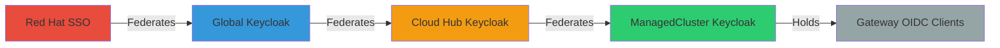
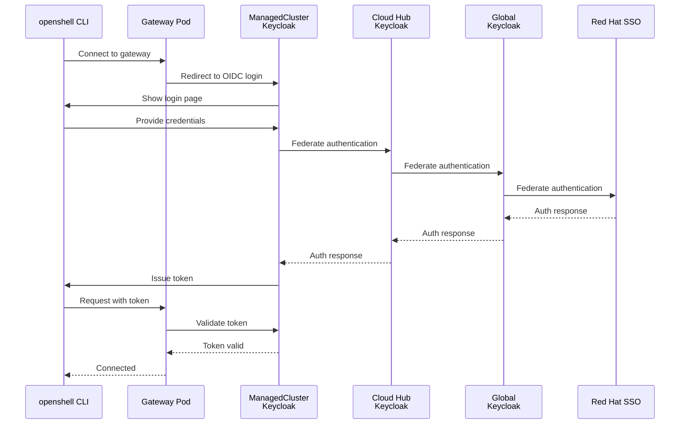
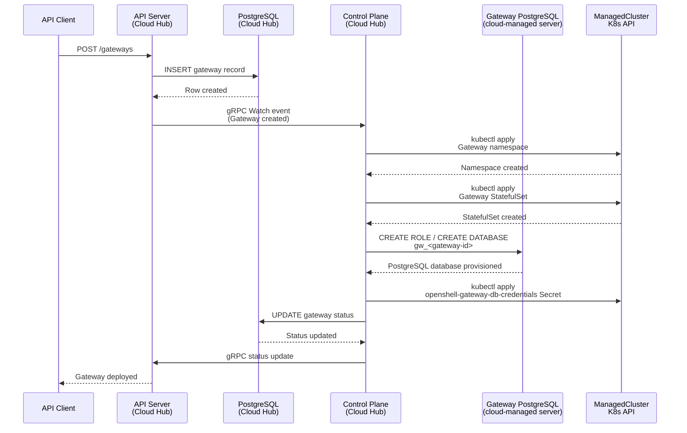
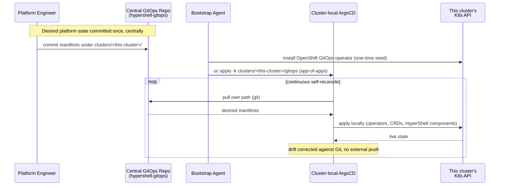
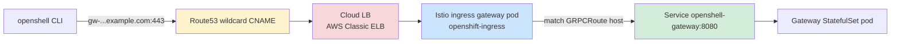
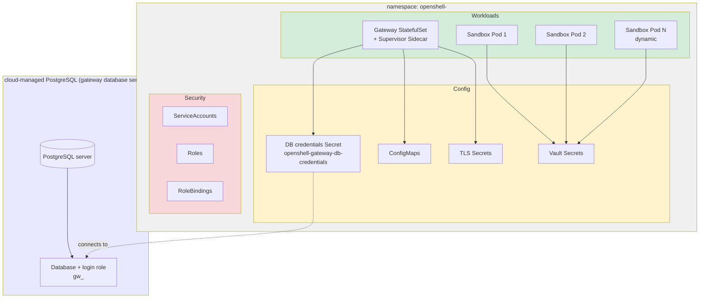
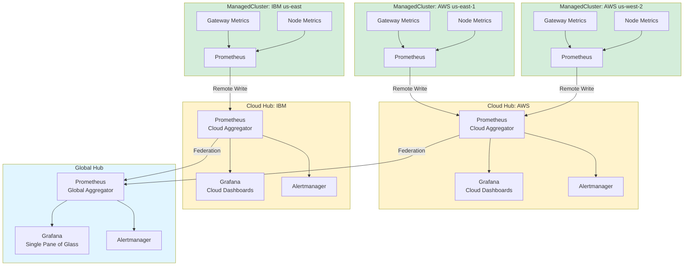

# Global Architecture

**Date:** 2026-08-14
**Status:** Active

## Overview

HyperShell deploys as a global fleet management platform spanning multiple clouds and regions. The architecture uses a **three-tier hub-and-spoke topology**: a Global Hub provides federated identity root, Cloud Hubs run the operational platform (API, control plane, databases), and ManagedClusters host OpenShell Gateway workloads. Every OpenShift cluster in the topology runs the full operator stack (ArgoCD, Vault, Keycloak, Prometheus, Grafana) but serves different purposes at each tier. PostgreSQL servers are provisioned outside the clusters as cloud-managed databases.

**Platform delivery is GitOps pull, not hub push.** ArgoCD runs on *every* cluster and reconciles **only itself**: each cluster's ArgoCD pulls its own path from a single central GitOps repository ([`hypershell-gitops`](https://github.com/openshift-online/hypershell-gitops)) and applies the operator stack and HyperShell platform components locally. No cluster stores another cluster's kubeconfig, and no central ArgoCD pushes manifests outward. The GitOps repo is the single source of desired *platform* state; a bootstrap agent seeds each cluster (installs ArgoCD and points it at the cluster's own path), after which the cluster self-reconciles.

> **Two distinct reconciliation planes; do not conflate them.** (1) **Platform GitOps** (this section) deploys the operator stack and HyperShell components; it is *pull*, sourced from Git, per cluster. (2) **Control-plane tenant reconciliation** (see "Control Plane Reconciliation Flow") provisions per-tenant OpenShell Gateway resources at runtime; it is *push* from the Cloud Hub control plane into ManagedClusters, sourced from the Cloud Hub PostgreSQL (the source of truth for tenant desired state) and driven by gRPC watch events. Inverting the GitOps layer to pull does **not** change the control-plane tenant plane.

> **Terminology.** "Gateway" is overloaded, so this document uses fully-qualified
> names. **OpenShell Gateway** is the tenant workload (the pod, its Supervisor,
> and its Sandboxes) that HyperShell provisions. **Gateway API** is the upstream
> Kubernetes API (`gateway.networking.k8s.io`); a **shared Gateway (Gateway API
> resource)** is a `Gateway` object under that API. Cloud load balancers are
> named by provider (AWS NLB/ELB, IBM Cloud VPC LB) rather than a bare
> "gateway". Unqualified "gateway" should be read as OpenShell Gateway.

## Three-Tier Topology

HyperShell uses a three-tier hub-and-spoke architecture. Each tier runs the full operator stack but serves distinct purposes.

```mermaid
graph TB
    Repo[(central GitOps repo<br/>hypershell-gitops)]

    subgraph Global["Global Hub (Identity Root)"]
        GArgo[ArgoCD<br/>self-reconcile]
        GK[Keycloak<br/>Federated to RH SSO]
        GV[Vault<br/>Reserved]
        GG[Grafana<br/>Cross-Cloud Dashboard]
    end

    subgraph AWS["Cloud Hub: AWS"]
        AArgo[ArgoCD<br/>self-reconcile]
        AK[Keycloak<br/>Federates to Global]
        AV[Vault<br/>Service Secrets]
        ADB[(PostgreSQL<br/>cloud-managed)]
        ACP[Control Plane]
        AAPI[API Server]
        AUI[Web UI]
        AP[Prometheus]
        AG[Grafana]
    end

    subgraph IBM["Cloud Hub: IBM Cloud"]
        IArgo[ArgoCD<br/>self-reconcile]
        IK[Keycloak<br/>Federates to Global]
        IV[Vault<br/>Service Secrets]
        IDB[(PostgreSQL<br/>cloud-managed)]
        ICP[Control Plane]
        IAPI[API Server]
        IUI[Web UI]
        IP[Prometheus]
        IG[Grafana]
    end

    subgraph MC1["ManagedCluster: AWS us-east-1"]
        M1Argo[ArgoCD<br/>self-reconcile]
        M1K[Keycloak<br/>Gateway Clients]
        M1V[Vault<br/>Gateway Secrets]
        M1DB[(PostgreSQL<br/>cloud-managed)]
        M1P[Prometheus]
        M1GW[Gateway Namespaces]
    end

    subgraph MC2["ManagedCluster: AWS us-west-2"]
        M2Argo[ArgoCD<br/>self-reconcile]
        M2K[Keycloak<br/>Gateway Clients]
        M2V[Vault<br/>Gateway Secrets]
        M2DB[(PostgreSQL<br/>cloud-managed)]
        M2P[Prometheus]
        M2GW[Gateway Namespaces]
    end

    subgraph MC3["ManagedCluster: IBM us-east"]
        M3Argo[ArgoCD<br/>self-reconcile]
        M3K[Keycloak<br/>Gateway Clients]
        M3V[Vault<br/>Gateway Secrets]
        M3DB[(PostgreSQL<br/>cloud-managed)]
        M3P[Prometheus]
        M3GW[Gateway Namespaces]
    end

    %% Platform GitOps: each cluster's ArgoCD PULLS its own path from the central repo
    Repo -.->|pull own path| GArgo
    Repo -.->|pull own path| AArgo
    Repo -.->|pull own path| IArgo
    Repo -.->|pull own path| M1Argo
    Repo -.->|pull own path| M2Argo
    Repo -.->|pull own path| M3Argo

    GK -->|Federation| AK
    GK -->|Federation| IK
    AK -->|Federation| M1K
    AK -->|Federation| M2K
    IK -->|Federation| M3K

    %% Control-plane tenant plane (runtime, DB-sourced) - distinct from GitOps pull above
    ACP -->|Reconcile tenants| M1GW
    ACP -->|Reconcile tenants| M2GW
    ICP -->|Reconcile tenants| M3GW
    
    M1P -->|Metrics| AP
    M2P -->|Metrics| AP
    M3P -->|Metrics| IP
    
    AP -->|Aggregate| GG
    IP -->|Aggregate| GG

    style Repo fill:#e2d4f0
    style Global fill:#e1f5ff
    style AWS fill:#fff3cd
    style IBM fill:#fff3cd
    style MC1 fill:#d4edda
    style MC2 fill:#d4edda
    style MC3 fill:#d4edda
```



### Tier 1: Global Hub

**Purpose**: Identity federation root and cross-cloud observability.

**Components**:
- ArgoCD (self-reconciles this hub's operator stack and config from its own path in the central GitOps repo)
- Keycloak (federates to Red Hat SSO)
- Vault (reserved for future global secrets)
- Grafana (single-pane-of-glass aggregating metrics from all Cloud Hubs)

**Operational Role**: Provides the root of the Keycloak federation chain. Cloud Hubs federate to Global Keycloak, which federates to Red Hat SSO. Future: global monitoring dashboard.

### Tier 2: Cloud Hub

**Purpose**: Primary operational unit. One highly-available instance per cloud provider.

**Components**:
- API Server, Control Plane, Web UI (HA deployment)
- PostgreSQL (cloud-managed, provisioned outside the cluster) - source of truth for Gateway, ManagedCluster resources
- ArgoCD - self-reconciles *this* Cloud Hub's operator stack and HyperShell platform components (API server, control plane, Web UI) by pulling its own path from the central GitOps repo; it does **not** reconcile into ManagedClusters
- Keycloak - federates to Global Keycloak, serves cloud services
- Vault - secrets for cloud hub services (API server, control plane)
- Prometheus - aggregates metrics from this cloud's ManagedClusters
- Grafana - cloud-level dashboards

**Operational Role**: The control plane is the *tenant* reconciliation engine for the fleet. It watches the API server via gRPC and provisions the full set of OpenShell resources into ManagedClusters - not just OpenShell Gateways, but the tenant namespaces, per-tenant PKI, RBAC, ingress objects, per-gateway databases, and supporting workloads each gateway depends on. This tenant plane is a runtime *push* sourced from the Cloud Hub PostgreSQL, and is distinct from platform GitOps.

The *platform* layer beneath it is pull-based GitOps: each ManagedCluster's own ArgoCD installs and self-reconciles that cluster's operator stack and baseline config from its own path in the central GitOps repo. So responsibilities split cleanly: a cluster's local ArgoCD owns the cluster's platform (operators, CRDs, cluster-scoped config), and the Cloud Hub control plane owns the tenant resources layered on top. The control plane never installs the operator stack on a ManagedCluster; it assumes the cluster has already self-reconciled it from Git.

### Tier 3: ManagedCluster

**Purpose**: Hosts OpenShell Gateway workloads - the OpenShell Gateway pod, its Supervisor, and the Sandboxes it launches to execute user sessions. Multiple per cloud, deployed close to users (regional).

**Components**:
- ArgoCD - self-reconciles this ManagedCluster's operator stack and baseline config from its own path in the central GitOps repo (pull); the Cloud Hub control plane layers tenant resources on top at runtime
- Keycloak - federates to Cloud Hub Keycloak, holds OIDC clients for OpenShell Gateways on this cluster
- Vault - keystore for gateway secrets
- PostgreSQL (cloud-managed gateway database server) - one database and login role per gateway (`gw_<gateway-id>`)
- Prometheus - local metrics (forwarded to Cloud Hub)
- Gateway namespaces (each contains: OpenShell Gateway pod, Supervisor, Sandboxes, DB credentials Secret, TLS secrets, RBAC)

**Operational Role**: Runs OpenShell Gateway workloads and the Sandboxes they spawn. Users authenticate openshell CLI against Keycloak on the ManagedCluster where their OpenShell Gateway lives.

## Data Flows

### Keycloak Federation Chain

Identity flows from Red Hat SSO down through the tier hierarchy. Each Keycloak federates to the one above it.



**Federation Path**: Red Hat SSO → Global Keycloak → Cloud Keycloak → ManagedCluster Keycloak

**Client Registration**: Gateway OIDC clients are registered in the ManagedCluster Keycloak where the gateway runs.

### Gateway Authentication Flow

When a user authenticates their openshell CLI to a gateway:



### Control Plane Reconciliation Flow

The control plane on the Cloud Hub watches the API server and reconciles gateway resources into ManagedClusters.



**Key Points**:
- PostgreSQL on the Cloud Hub (the HyperShell API server's database) is the source of truth for the **desired state** of HyperShell-managed resources - Gateway, ManagedCluster, and related records. It is not a source of truth for every datum in the system.
- Runtime state owned by each OpenShell Gateway (active Sandboxes, provider credentials, live sessions) lives in that gateway's own database on its ManagedCluster, not in the Cloud Hub PostgreSQL. Where a fact could live in either store, this document names which one owns it.
- Control Plane watches API server via gRPC streams
- One control plane runs in every ManagedCluster (including the Cloud Hub's own cluster), registers itself with the Cloud Hub API server, and reconciles the *tenant* resources assigned to its `cluster_id` into its own cluster with in-cluster credentials. No hub holds a spoke kubeconfig (`platform/control-plane.spec.md`, `platform/managed-cluster-registration.spec.md`). This runtime tenant plane is distinct from the platform GitOps pull below.
- Gateway databases live on a cloud-managed PostgreSQL server whose admin credentials are mounted into the control plane - one database and login role per gateway (`gw_<gateway-id>`) - not in any cluster; only the DB credentials Secret is written into the gateway namespace

### Platform GitOps Pull Flow

The platform layer (operator stack + HyperShell components) is delivered by each cluster's *own* ArgoCD pulling from the central GitOps repo. There is no central ArgoCD holding remote kubeconfigs and no push from a hub; every cluster reconciles itself.



**Key Points**:
- ArgoCD runs on every cluster and syncs **only that cluster's own path** in the central repo. No cluster holds another cluster's credentials.
- The central GitOps repo is the single source of truth for **platform** desired state (operators, CRDs, HyperShell component manifests). It is *not* the source of truth for tenant gateways; those live in the Cloud Hub PostgreSQL and flow through the control plane (above).
- `bin/bootstrap <cluster>` (in `hypershell-gitops`) performs the one-time seed: install the OpenShift GitOps operator, then `oc apply -k clusters/<cluster>/gitops` (the app-of-apps). Steady-state reconciliation is pull-only.
- A hub outage does not stop a ManagedCluster from reconciling its platform; each cluster is self-sufficient against Git.


## Ingress Architecture

HyperShell utilizes a **dual-ingress strategy** on OpenShift clusters, separating platform management traffic from tenant gateway traffic. This ensures isolation, security, and optimal routing for different protocols.

### 1. Platform Services (Default OpenShift Ingress)

Traffic destined for HyperShell management services (API Server, Web Console, Keycloak) uses the default OpenShift routing tier.

- **Domain:** Standard OpenShift wildcard domain (e.g., `*.apps.rosa...`)
- **Load Balancer:** The cloud's own load balancer fronting the OpenShift router. This is provider-specific: **AWS** uses an internal Network Load Balancer (NLB); **IBM Cloud** (our ROKS clusters) uses a VPC Load Balancer. The same pattern recurs on any cloud we onboard - an Azure Load Balancer equivalent would slot in here - so we describe the role generically and name the concrete instances we run today. (Azure is listed only when we actually deploy there.)
- **Routing Object:** OpenShift `Route` (HAProxy)
- **Mechanism:** The wildcard DNS resolves to the cloud load balancer, which forwards traffic to the OpenShift router pods. HAProxy uses hostname-based routing to direct traffic to the correct service.

### 2. Tenant Gateways (Kubernetes Gateway API)

Traffic destined for the actual managed gRPC gateways bypasses the default OpenShift router and uses a dedicated ingress path managed by the Kubernetes Gateway API (backed by Istio).

- **Domain:** Dedicated base domain (e.g., `*.openshell.stage.example.com`)
- **Load Balancer:** Dedicated AWS Classic ELB (provisioned by the Gateway API controller)
- **Routing Object:** `GRPCRoute` attached to a central `Gateway`
- **Mechanism:** A single shared Gateway (Gateway API resource) `openshell-grpc-gateway` in the `openshift-ingress` namespace terminates TLS using a wildcard certificate. When the control plane provisions a new OpenShell Gateway in a tenant namespace, it creates a `GRPCRoute` that automatically attaches to this shared Gateway (Gateway API resource). External DNS (e.g., Route53) manages the CNAME mapping the wildcard domain to the AWS ELB address.

This architecture allows the control plane to dynamically route traffic for new OpenShell Gateways without needing to provision individual load balancers or DNS records per tenant.

### Tenant gateway ingress is environment-adaptive (two modes)

Not every cluster can run the Gateway API. HyperShell is composable per
environment (see the deploy overlays), so the tenant-gateway ingress path is a
**selectable mode**, chosen by configuration, not by forking behavior:

| Mode | Routing object | When to use | Externally provisioned by |
|------|----------------|-------------|---------------------------|
| **`gateway-api`** (reference) | `GRPCRoute` → shared `Gateway` | Gateway API GA and functional (AWS/ROSA, OCP ≥ 4.19 with working CIO Istio) | Shared `Gateway` + wildcard cert + Route53 CNAME |
| **`route`** | OpenShift `Route` (`passthrough`) | Fallback for OpenShift without a working Gateway API (for example OCP < 4.19). No live controller uses it | Cluster's default router (HAProxy) on the platform wildcard |

Both modes converge on the **same** tenant workload, which presents two server
certificates by SNI (the dual-certificate model from
[NVIDIA/OpenShell#2468](https://github.com/NVIDIA/OpenShell/pull/2468)):

1. **Internal cert** - the per-tenant self-signed CA (`openshell-ca` →
   `openshell-server-tls`) covering the cluster-local Service names on the
   supervisor↔gateway path. Supervisors trust **only** this per-tenant chart CA
   (never WebPKI); that is what blocks a malicious sandbox image from MITM-ing
   the supervisor connection. This internal CA is always present.
2. **External cert** - a certificate signed by a **trusted CA**, minted by an
   **operator-configured** cert-manager `Issuer`/`ClusterIssuer` (for example
   ACME / Let's Encrypt), covering the **public SANs**
   (`gw-<tenant>.<base-domain>`) used by the `openshell` CLI and the OpenShift
   `Route`. Because it chains to a publicly trusted root, the CLI needs no custom
   CA bundle.

Client **identity** is established by OIDC (Keycloak bearer tokens), never client
certificates - HyperShell does not require or support client mTLS. TLS is
server-side transport encryption only; callers are authenticated by OIDC.

In `route` mode the `Route` is `passthrough`: the router forwards the encrypted
connection SNI-routed end-to-end and the gateway pod serves the **external
trusted cert** on the public SAN. No shared `Gateway`, wildcard certificate, or
GRPCRoute machinery is required - only the operator-configured `Issuer` for the
external cert. In `gateway-api` mode the shared `Gateway` terminates the client's
TLS and re-encrypts to the backend, validated by a `BackendTLSPolicy`.

> **Current limitation (tracked).** The external trusted cert requires an
> ACME-solvable domain the operator controls. On a Cloud Hub that only exposes
> the provider's shared ingress wildcard it does not own (for example IBM ROKS'
> `*.containers.appdomain.cloud`), a publicly trusted cert is not yet issuable,
> so `route` mode there still serves the internal `openshell-ca` and the CLI must
> pin that CA. Wiring the operator-configured external `Issuer`
> (`serverIssuerRef` / `external_server_names`, per OpenShell#2468) end-to-end is
> tracked follow-up work.

The mode is set by the control-plane env var `GATEWAY_INGRESS_MODE`
(`gateway-api` | `route` | `none`). When unset it is auto-detected from cluster
capabilities (`gateway-api` if the Gateway API is present, else `route` on
OpenShift). A platform that ships the Gateway API CRDs but cannot run it sets
`GATEWAY_INGRESS_MODE=route` explicitly through its kustomize overlay. See
"Requirement: Control Plane Ingress Mode".

### Tenant Gateway Ingress - Reference Implementation (verified on AWS)

> The following was captured live from the `hypershell-stage` deployment on the
> ROSA cluster `hcmais01ue1` (2026-08-15). It is the source-of-truth
> implementation that other clouds (IBM Cloud) must reach parity with. Values
> such as ELB hostnames and tenant hashes are environment-specific.

#### Component chain



The Gateway API implementation is **OpenShift's built-in support**, not a manual
Istio install. The Cluster Ingress Operator (CIO) installs and manages `istiod`
(Sail operator) and reconciles the `openshift-default` GatewayClass.

- **GatewayClass:** `openshift-default`
- **Controller:** `openshift.io/gateway-controller/v1` ("Handled by Istio controller"; `istiod v1.28.5` installed by CIO)
- **Gateway → LoadBalancer:** creating the `Gateway` causes the operator to create an Istio ingress `Deployment` + `Service` (`type: LoadBalancer`); the cloud CCM then provisions the external LB (AWS Classic ELB observed: `a1a663034da9843c3944de9cbdaceb98-536422505.us-east-1.elb.amazonaws.com`).

#### Manifest 1 - Shared Gateway (one per cluster, in `openshift-ingress`)

Created/owned by the control plane (`app.kubernetes.io/managed-by: hypershell-control-plane`).

```yaml
apiVersion: gateway.networking.k8s.io/v1
kind: Gateway
metadata:
  name: openshell-grpc-gateway
  namespace: openshift-ingress
  labels:
    app.kubernetes.io/name: openshell
    app.kubernetes.io/component: gateway
    app.kubernetes.io/managed-by: hypershell-control-plane
    hypershell.redhat.io/managed: "true"
    istio.io/rev: openshift-gateway
spec:
  gatewayClassName: openshift-default
  listeners:
    - name: grpc
      hostname: "*.openshell.stage.example.com"   # per-env base domain
      port: 443
      protocol: HTTPS
      allowedRoutes:
        kinds:
          - group: gateway.networking.k8s.io
            kind: GRPCRoute
        namespaces:
          from: All                                 # tenant namespaces attach cross-namespace
      tls:
        mode: Terminate
        certificateRefs:
          - kind: Secret
            name: wildcard-openshell-stage-example-tls
```

#### Manifest 2 - Per-tenant GRPCRoute (control plane creates one per gateway)

Lives in the tenant namespace (`openshell-<tenant-hash>`), attaches cross-namespace to the shared Gateway's `grpc` listener.

```yaml
apiVersion: gateway.networking.k8s.io/v1
kind: GRPCRoute
metadata:
  name: openshell-gateway
  namespace: openshell-<tenant-hash>
  labels:
    app.kubernetes.io/name: openshell
    app.kubernetes.io/component: gateway
    app.kubernetes.io/managed-by: hypershell-control-plane
    hypershell.redhat.io/managed: "true"
spec:
  hostnames:
    - "gw-openshell-<tenant-hash>.openshell.stage.example.com"
  parentRefs:
    - group: gateway.networking.k8s.io
      kind: Gateway
      name: openshell-grpc-gateway
      namespace: openshift-ingress
      sectionName: grpc
  rules:
    - backendRefs:
        - kind: Service
          name: openshell-gateway
          port: 8080
          weight: 1
```

#### Manifest 3 - Wildcard TLS certificate (cert-manager, in `openshift-ingress`)

```yaml
apiVersion: cert-manager.io/v1
kind: Certificate
metadata:
  name: wildcard-openshell-stage-example
  namespace: openshift-ingress
spec:
  secretName: wildcard-openshell-stage-example-tls
  dnsNames:
    - "*.openshell.stage.example.com"
  issuerRef:
    kind: ClusterIssuer
    name: letsencrypt-examplecom-dns
```

#### Manifest 4 - ClusterIssuer (ACME / Let's Encrypt, DNS-01 via Route53)

The `example.com` zone is centrally hosted in AWS Route53, so the DNS-01 solver
is Route53 **regardless of which cloud the cluster runs in**. This is the key that
lets an IBM Cloud cluster obtain a `*.example.com` certificate without any
IBM-native DNS integration.

```yaml
apiVersion: cert-manager.io/v1
kind: ClusterIssuer
metadata:
  name: letsencrypt-examplecom-dns
spec:
  acme:
    solvers:
      - selector:
          dnsZones: ["example.com"]
        dns01:
          route53:
            region: global
            hostedZoneID: Z05758033SZ8IESGUOY8E
            accessKeyIDSecretRef:
              name: certmgr-<cluster>-example-com-sa
              key: aws_access_key_id
            secretAccessKeySecretRef:
              name: certmgr-<cluster>-example-com-sa
              key: aws_secret_access_key
```

#### DNS record

There is **no `external-dns` controller** on the AWS cluster; the Gateway reports
`DNS management policy is set to Unmanaged`. The wildcard record is a static
Route53 entry:

```
*.openshell.stage.example.com.  CNAME  <cloud-LB-hostname>
```

resolving to the Gateway's provisioned LB. It must be created (once per cluster)
after the LB hostname is known.

#### Verified component summary

| Concern | AWS (verified) | Notes |
|---------|----------------|-------|
| Gateway API impl | `openshift-default` GatewayClass, CIO-managed Istio | Not a manual Istio install |
| Shared Gateway | `openshell-grpc-gateway` / `openshift-ingress` | one per cluster |
| Listener | `*.openshell.stage.example.com`, 443, HTTPS, TLS Terminate | GRPCRoute from All namespaces |
| External LB | AWS Classic ELB (auto-provisioned) | via `Service type: LoadBalancer` + CCM |
| Per-tenant route | `GRPCRoute` `openshell-gateway`, host `gw-openshell-<hash>...`, backend `Service openshell-gateway:8080` | created by control plane |
| Wildcard cert | cert-manager `Certificate` → secret `wildcard-openshell-stage-example-tls` | 90-day Let's Encrypt, auto-renew |
| Issuer | `letsencrypt-examplecom-dns` (ACME, DNS-01, Route53 zone `example.com`) | cloud-agnostic |
| DNS record | static Route53 wildcard CNAME → LB | no external-dns |

### IBM Cloud Cloud Hub - Gateway API ingress (verified 2026-10-26)

IBM Cloud ROKS 4.22 and later runs a working Gateway API controller, so the
IBM Cloud Hubs use the reference `gateway-api` mode, the same as AWS. Live
check on 2026-10-26: the controllers on `hypc-ibm-00` (`hyp0`, `hyp0-spoke1`)
and `hypc-ibm-03` (`hyp2-spoke1`) leave `GATEWAY_INGRESS_MODE` unset, auto-detect
`gateway-api`, and publish one `GRPCRoute` per gateway. No OpenShift `Route` is
created for gateway traffic.

Older ROKS releases (4.21 and earlier) could not run the Gateway API: the
CIO-managed Istio could not pull its images on the HyperShift-hosted cluster.
On such a cluster the `route` mode is the fallback. Cluster provisioning steps
live in [`ibm-cluster`](../../skills/deploy/ibm-cluster/SKILL.md).

### Requirement: PLAT-ARCH-05 -- Tenant Gateway Ingress via Gateway API (`gateway-api` mode)

In `gateway-api` mode, tenant gateway traffic SHALL be routed through the
Kubernetes Gateway API using a single shared `Gateway` (`openshell-grpc-gateway`)
in the `openshift-ingress` namespace. In this mode tenant gateways SHALL NOT use
OpenShift `Route` objects for data-plane gRPC traffic.

#### Scenario: PLAT-ARCH-05.01 -- Gateway provisioning creates a GRPCRoute

- GIVEN a cluster in `gateway-api` mode with the `openshift-default` GatewayClass and the shared `openshell-grpc-gateway`
- WHEN the control plane provisions a new tenant gateway
- THEN it SHALL create a `GRPCRoute` in the tenant namespace with a `parentRef` to `openshell-grpc-gateway` (`sectionName: grpc`)
- AND the route hostname SHALL be `gw-<tenant>.<base-domain>` under the shared listener's wildcard
- AND it SHALL NOT create an OpenShift `Route` for gRPC data-plane traffic

### Requirement: PLAT-ARCH-06 -- Tenant Gateway Ingress via OpenShift Route (`route` mode)

In `route` mode, tenant gateway traffic SHALL be exposed through an OpenShift
`Route` with `tls.termination: passthrough`. The gateway Helm chart owns this
`Route` (`openshiftRoute.enabled=true`); the control plane derives its host and
publishes the route address. The router forwards the raw TLS stream, so the
gateway pod's own server TLS is preserved end to end. In this mode the control
plane SHALL NOT require a shared `Gateway`, a wildcard certificate, or external
DNS integration.

#### Scenario: PLAT-ARCH-06.01 -- Gateway provisioning creates a passthrough Route

- GIVEN a cluster in `route` mode (`GATEWAY_INGRESS_MODE=route`)
- WHEN the control plane provisions a new tenant gateway with ingress enabled
- THEN the gateway Helm release SHALL create a passthrough `Route` `openshell-gateway` in the tenant namespace, backed by `Service openshell-gateway`
- AND the route hostname SHALL be `gw-<tenant>.<base-domain>` (or the gateway's explicit `route.host`)
- AND the control plane SHALL publish `grpcs://<host>:443` as the gateway's route address
- AND it SHALL NOT create a `GRPCRoute`, shared `Gateway`, or `BackendTLSPolicy`

#### Scenario: PLAT-ARCH-06.04 -- Disabling ingress removes the mode's routing objects

- GIVEN a provisioned tenant gateway with a routing object for the active mode
- WHEN ingress is disabled (`route.enabled=false`) or the gateway is deleted
- THEN the control plane SHALL delete the tenant's `Route` (route mode) or `GRPCRoute`/`BackendTLSPolicy` (gateway-api mode)
- AND it SHALL clear the gateway's route address

### Requirement: PLAT-ARCH-07 -- Cloud-Agnostic Gateway Manifests

The `Gateway`, `GRPCRoute`, `Certificate`, and `ClusterIssuer` manifests SHALL be
identical across clouds except for the per-environment base domain and TLS secret
name. The external load balancer SHALL be provisioned automatically by the cloud's
CCM from the operator-created `Service type: LoadBalancer`; no per-cloud load
balancer manifest SHALL be required.

#### Scenario: PLAT-ARCH-07.01 -- IBM Cloud provisions a VPC LB from the same Gateway

- GIVEN the shared `Gateway` manifest applied on a ROKS VPC Gen2 cluster
- WHEN the Cluster Ingress Operator reconciles it
- THEN IBM Cloud CCM SHALL provision a VPC Load Balancer (`*.lb.appdomain.cloud`)
- AND the `Gateway` status SHALL report `Programmed=True` with the LB hostname as its address

### Requirement: PLAT-ARCH-08 -- Wildcard TLS via Central Route53 DNS-01

Wildcard certificates for the `example.com` base domain SHALL be issued by
cert-manager using the ACME DNS-01 challenge against the central Route53
`example.com` hosted zone, independent of the cluster's cloud provider.

### Requirement: PLAT-ARCH-09 -- Control Plane Ingress Mode

The control plane's ingress mode (`gateway-api` vs `route`) SHALL be
configuration-driven, not cloud-hardcoded, so the same binary produces `GRPCRoute`s
or OpenShift `Route`s depending only on the selected mode. The mode SHALL be
selectable via the `GATEWAY_INGRESS_MODE` env var (`gateway-api` | `route` |
`none`), overridable per environment through a kustomize overlay
(`deploy/openshift` defaults to `gateway-api`).

#### Scenario: PLAT-ARCH-09.01 -- Explicit mode overrides auto-detection

- GIVEN a cluster where the Gateway API CRDs are present but non-functional
- WHEN `GATEWAY_INGRESS_MODE=route` is set
- THEN the control plane SHALL provision OpenShift `Route`s and SHALL NOT attempt Gateway API resources

#### Scenario: PLAT-ARCH-09.02 -- Auto-detection when no mode is set

- GIVEN `GATEWAY_INGRESS_MODE` is unset
- WHEN the control plane reconciles a gateway
- THEN it SHALL select `gateway-api` if the Gateway API is detected, otherwise `route` on OpenShift, otherwise skip managed ingress

### Requirement: PLAT-ARCH-12 -- cert-manager Is a Mode-Independent Prerequisite

Every tenant gateway SHALL depend on cert-manager for its per-tenant PKI: a
namespaced `Issuer` (`openshell-ca`) and `Certificate`s minting the gateway's own
server TLS and CA. This is independent of the ingress mode - `route`
mode removes only the ingress-layer wildcard certificate/`ClusterIssuer`/Route53,
not the pod-TLS layer. The control plane SHALL fail closed when cert-manager is
absent.

#### Scenario: PLAT-ARCH-12.01 -- Reconcile blocks without cert-manager

- GIVEN a cluster without cert-manager installed (any ingress mode)
- WHEN the control plane reconciles a tenant gateway
- THEN it SHALL return an error and SHALL NOT deploy the gateway workload

### Requirement: PLAT-ARCH-13 -- Public Ingress Uses a Trusted External Certificate

Per [NVIDIA/OpenShell#2468](https://github.com/NVIDIA/OpenShell/pull/2468), the
certificate served on the **public** ingress hostname (`gw-<tenant>.<base-domain>`)
SHALL chain to a **publicly trusted CA**, minted by an **operator-configured**
cert-manager `Issuer`/`ClusterIssuer` (for example ACME / Let's Encrypt) whose
DNS-01/HTTP-01 challenge the operator can solve for a zone it controls. The
gateway pod SHALL present this external cert (via `external_cert_path` /
`external_key_path` / `external_server_names`, selected by SNI) so the `openshell`
CLI connects with **no custom CA bundle**. This is independent of the per-tenant
self-signed `openshell-ca`, which is retained for the supervisor↔gateway path
(supervisors trust only the chart CA, blocking MITM from a malicious sandbox
image). Where the operator does not control the ingress zone (for example IBM
ROKS' shared `*.containers.appdomain.cloud` wildcard), no publicly trusted cert is
issuable; the gateway SHALL fall back to serving the internal `openshell-ca` and
the CLI SHALL pin it. Wiring the external `Issuer` (`serverIssuerRef` /
`external_server_names`) end-to-end is tracked follow-up work.

#### Scenario: PLAT-ARCH-13.01 -- CLI connects to a trusted public endpoint without a custom CA

- GIVEN an operator-configured external `Issuer` for a zone the operator controls
- AND a tenant gateway provisioned with a public SAN under that zone
- WHEN the `openshell` CLI connects to `gw-<tenant>.<base-domain>:443`
- THEN the served certificate SHALL chain to a publicly trusted root
- AND the CLI SHALL verify it using only the system trust store

### Requirement: PLAT-ARCH-14 -- Gateway Server Certificate Covers the Ingress Hostname

Because both ingress modes carry the gateway pod's TLS through unmodified (Route
passthrough / Gateway API `BackendTLSPolicy`), the gateway server certificate
SHALL list the external ingress hostname (`gw-<tenant>.<base-domain>`, or an
explicit `route.host`) as a SAN. The control plane derives that hostname, so it
SHALL inject it into the certificate SANs itself, before cert-manager mints the
certificate. `external_dns` and `server_dns_names` are control-plane-managed and
are not operator-settable inputs (see [`data-model.spec.md`](./data-model.spec.md),
"Requirement: Gateway Field Ownership and Write Policy", PLAT-DATA-23); the ingress
hostname is covered without any operator-authored DNS field.

#### Scenario: PLAT-ARCH-14.01 -- Derived hostname appears in the served certificate

- GIVEN a tenant gateway with ingress enabled and `GATEWAY_API_BASE_DOMAIN` set
- WHEN the control plane provisions it
- THEN the certificate served over the ingress hostname SHALL include
  `gw-<tenant>.<base-domain>` as a SAN, with hostname verification enabled
- AND that certificate SHALL chain to the operator-configured external trusted CA
  where one is available for the zone, otherwise to the per-tenant `openshell-ca`
  (which the CLI must then pin)

### Requirement: PLAT-ARCH-15 -- Image References Support an In-Cluster Registry

Gateway image references (gateway, supervisor) SHALL accept a registry host that
carries an explicit port, as standard Docker references permit
(`host[:port]/path[:tag]`), so images mirrored into the cluster-internal registry
(`image-registry.openshift-image-registry.svc:5000/...`) - the only node-reachable
source on ROKS - pass validation. The gateway's
`supervisor_image` SHALL be settable through the API (`PATCH`) so sandboxes pull
from a node-reachable registry.

### Requirement: PLAT-ARCH-16 -- Agent Sandbox CRD Is a Sandbox Prerequisite

Tenant sandbox operations (`openshell sandbox list/create`) depend on the Agent
Sandbox CRD + controller (`sandboxes.agents.x-k8s.io`, the upstream
`kubernetes-sigs/agent-sandbox` project) being installed cluster-wide. The control
plane SHALL provision only the per-tenant sandbox RBAC (SA, Role/RoleBinding
against `agents.x-k8s.io`, and on OpenShift the privileged-SCC binding); it SHALL
NOT install the CRD/controller, which is a cluster prerequisite on par with
cert-manager. The gateway's Kubernetes compute driver watches this CRD; when it is
absent the sandbox RPCs surface as gRPC `Unimplemented` and the driver logs `no
supported Agent Sandbox API version is available`. The version installed SHALL
serve the API version the gateway requires (`v1beta1` for gateway 0.1.6-rhaiv.4; upstream
`v0.5.x`).

### Requirement: PLAT-ARCH-17 -- Sandbox Base Image Supports an In-Cluster Registry

Sandbox creation SHALL support selecting a node-reachable workload image through
OpenShell's `sandbox create --from <image>` interface. On clusters without public
registry access (e.g. ROKS), callers SHALL select a mirrored image in the
cluster-internal registry. When no image is selected, the vendored chart supplies
the gateway's default workload image through `sandbox.image`.

#### Scenario: PLAT-ARCH-17.01 -- Sandbox launch on a cluster without public egress

- GIVEN a cluster whose worker nodes cannot pull from `ghcr.io` or `registry.k8s.io`
- AND the Agent Sandbox CRD + controller and the sandbox base image have been mirrored into the internal registry
- WHEN the caller creates a sandbox with `--from <internal-registry-image>`
- THEN a created Sandbox's pod SHALL pull the base image from the internal registry and reach Running
- AND the gateway compute driver SHALL watch `agents.x-k8s.io` without `Unimplemented` errors

### Open Questions (for implementer review)

1. **[RESOLVED] ROKS Gateway API availability.** ROKS 4.22 and later runs a working Gateway API controller. The IBM Cloud Hubs use `gateway-api` mode (verified live on 2026-10-26, see "IBM Cloud Cloud Hub - Gateway API ingress"). The earlier blocker on ROKS 4.21 (`hysh-ibm-01`, 2026-08-15) no longer applies.
2. **IBM base domain.** What exact subdomain - e.g. `openshell.ibm-stage.example.com`?
   Confirm it is delegated within the Route53 `example.com` zone.
3. **DNS record creation.** Reproduce the AWS pattern (static Route53 wildcard
   CNAME, no external-dns), or introduce `external-dns` to automate it on IBM?
4. **Route53 credentials on IBM.** Provision the `certmgr-<cluster>-example-com-sa`
   secret (IAM user scoped to the `example.com` zone) on the IBM cluster.
5. **Legacy Route-based gateways.** The AWS cluster still has older tenants on
   `Route`/`passthrough` under `*.apps.rosa...`. Is a migration of existing tenants
   in scope, or parity for new tenants only?

## Tooling Stack

| Component | Tool | Purpose |
|-----------|------|---------|
| Databases | Cloud-managed PostgreSQL (AWS RDS/Aurora, IBM Cloud Databases) | Platform, Keycloak, and gateway databases; provisioned outside the clusters |
| GitOps | ArgoCD (on every cluster) | Each cluster self-reconciles its own platform state by pulling its path from the central GitOps repo (pull model) |
| Secret management | Vault | Stores and rotates secrets with cloud-native drivers |
| Identity | Keycloak | OIDC authentication for gateways and console |
| Cluster provisioning | Terraform | VPC, subnet, and cluster provisioning |
| Monitoring | Prometheus | Metrics collection on all clusters |
| Dashboards | Grafana | Centralized visualization on hub |

## Database Strategy

Every PostgreSQL server HyperShell uses - the platform database, the Keycloak
database, and the servers that host gateway databases - is provisioned **outside the
clusters** as a cloud-managed database (AWS RDS/Aurora, IBM Cloud Databases) by the
platform team or IaC. No database operator and no in-cluster PostgreSQL workload runs
in any production tier.

For gateway databases, each HyperShell installation is given one administrative
credential set for its pre-existing server - the `hypershell-gateway-database-admin`
Secret mounted into the control plane - and provisions one database and one login
role per gateway inside that server over a `verify-full` TLS connection. HyperShell
never creates, resizes, or deletes a server, and the server is not an API resource.
There is a single provisioning model with no provider selection. See
[`openshell-gateway-database.spec.md`](./openshell-gateway-database.spec.md).

Cloud-managed servers supply the backup, point-in-time recovery, and HA properties the
platform relies on, so HyperShell does not reimplement them.

### Requirement: PLAT-ARCH-18 -- Externally Provisioned Gateway Database Servers

Gateway database servers SHALL be provisioned outside the clusters and their admin
credentials supplied to the control plane as a mounted Secret. The control plane SHALL
provision each gateway's database and role on that server with in-process DDL, and
SHALL write only the `openshell-gateway-db-credentials` Secret into the gateway
namespace.

#### Scenario: PLAT-ARCH-18.01 -- Gateway Database Provisioning

- GIVEN a Gateway resource and a control plane with valid mounted admin credentials
- WHEN the control plane reconciles the Gateway
- THEN it SHALL create the database and login role `gw_<gateway-id>` on the server
- AND it SHALL create no PostgreSQL workload in any cluster
- AND it SHALL write the `openshell-gateway-db-credentials` Secret into the gateway namespace

### Requirement: PLAT-ARCH-19 -- Database Server Lifecycle Independence

The gateway database server SHALL have an independent lifecycle from Gateways: HyperShell never creates or deletes it, and a single server serves every gateway of the installation, each via its own database and role.

## Namespace Strategy

Gateway and its sandboxes coexist in the same namespace as a scalable unit. Each gateway deployment gets its own namespace containing its workloads, config, and security resources. Its database lives on the registered PostgreSQL server outside the cluster (see below).



**Resources per Gateway Namespace**:
- **Workloads**: Gateway StatefulSet (with Supervisor sidecar), dynamic Sandbox pods
- **Config**: ConfigMaps, TLS secrets (cert-manager or certgen), Vault-backed secrets, `openshell-gateway-db-credentials`
- **Security**: ServiceAccounts, Roles, RoleBindings

**Gateway Database (outside the cluster)**: Provisioned by the control plane on the registered PostgreSQL server - a per-gateway database and login role (`gw_<gateway-id>`). See the [naming & multi-tenancy standard](../standards/platform/naming-multitenancy.spec.md).

This namespace-per-gateway strategy provides:
- Isolation boundary for RBAC
- Resource quotas per gateway
- Self-contained workload lifecycle (delete namespace = delete gateway workload; the gateway database is dropped independently)
- One shared server per installation, reducing the Postgres footprint across gateways

## Monitoring Architecture

Prometheus runs on every cluster. Metrics flow from ManagedClusters → Cloud Hub → Global Hub.



### Requirement: PLAT-ARCH-22 -- Managed Cluster Metrics

Every managed cluster SHALL run a Prometheus instance that scrapes gateway and node metrics. Metrics SHALL be forwarded to the regional or global hub.

### Requirement: PLAT-ARCH-23 -- Hub Dashboards

The hub cluster SHALL run Grafana with dashboards for fleet-wide gateway health, resource utilization, and provisioning status across all managed clusters.

## Managed Cluster Flexibility

Managed clusters are not restricted to OpenShift. Standard Kubernetes distributions (EKS, GKE, vanilla K8s) are valid targets. The controller auto-detects cluster capabilities:

| Capability | Detection | Behavior when absent |
|------------|-----------|---------------------|
| OpenShift Routes | `route.openshift.io` API group | Use Gateway API or NodePort |
| cert-manager | `cert-manager.io` API group | Block deployment (required) |
| Gateway API | `gateway.networking.k8s.io/v1` GRPCRoute | Skip GRPCRoute/BackendTLSPolicy |
| Agent Sandbox CRD | `agents.x-k8s.io` | Sandbox creation blocked |

## GitOps Repository Structure

The central [`hypershell-gitops`](https://github.com/openshift-online/hypershell-gitops)
repository is the single source of truth for **platform** desired state. It is
organized for the **pull model**: reusable `bases/` hold shared, cluster-agnostic
manifests, and each cluster gets its own directory under `clusters/` whose own
in-cluster ArgoCD applies it. There is no hub-side `Application` that targets a
remote cluster; **every** ArgoCD `Application`/`ApplicationSet` in the repo has
`destination: name: in-cluster`, so a cluster's directory *is* its own entrypoint.

The repository README's
[Directory Structure](https://github.com/openshift-online/hypershell-gitops#-directory-structure)
section is the authoritative tree. Cluster directories come in two shapes:

- **Numbered phases** (`hypc-*`, `hshells01ue1`, `hshellp01ue1`):
  `1-terraform/`, `2-configuration/`, `2-db-and-secrets/`, `3-bootstrap-apps/`
  and `delivery/`. Clusters that host HyperShell units add a `topology.json`
  that records their hub and spoke units.
- **App-of-apps** (`hysh-ibm-01`, `hysh-aws-01`): `gitops/` is
  the entrypoint that `bin/bootstrap <cluster>` applies; `apps/` holds the
  overlays its Applications point at; `operators/` holds the cluster's OLM
  Subscriptions.

**How a cluster self-reconciles:**

1. Install the OpenShift GitOps operator on the cluster. `bin/bootstrap <cluster>`
   does this via OLM; on ROKS (`hysh-ibm-01`) OperatorHub is unusable, so it is
   installed from raw manifests out-of-band first.
2. `oc apply -k clusters/<cluster>/gitops`, the self-contained app-of-apps. That
   cluster's in-cluster ArgoCD then reconciles everything by sync-wave: operators →
   Vault/ESO → postgres → Keycloak → HyperShell instances, all `in-cluster`.
3. Add a HyperShell instance by committing
   `clusters/<cluster>/apps/hypershell/<name>/{app.yaml,kustomization.yaml}`; the
   `hypershell` `ApplicationSet`'s git-file generator discovers the descriptor and
   creates one Application per instance automatically.
4. Onboard a new cluster by adding a `clusters/<name>/` directory (its own
   `gitops/` + `apps/` + `operators/`, referencing the shared `bases/`) and running
   `bin/bootstrap <name>`. No existing cluster's config changes, and no central
   credential store grows.

The canonical repo URL is set once per cluster in `gitops/repo-url-patch.yaml` (a
`repo-config` ConfigMap) and propagated to every `Application`/`ApplicationSet` via
a Kustomize `replacements` rule, so each cluster's ArgoCD resolves the same central
repo while syncing a different path. To fork the repo, edit only that file.

## Design Decisions

| Decision | Rationale |
|----------|-----------|
| Three-tier topology | Separates concerns: Global (identity root), Cloud Hub (operations), ManagedCluster (workloads) |
| Cloud Hub as primary unit | One HA instance per cloud runs API/control-plane/database; cloud isolation for latency and compliance |
| Full operator stack on all tiers | Every cluster has ArgoCD, Vault, Keycloak, Prometheus - but serves different purposes per tier. Because each cluster's own ArgoCD installs its stack from Git, the stack is present before any tenant workload lands. |
| Federated Keycloak chain | RH SSO → Global → Cloud Hub → ManagedCluster - identity flows down, authentication bubbles up |
| Vault per tier with distinct purposes | Cloud Hub Vault: service secrets; ManagedCluster Vault: gateway keystores |
| Cloud-managed PostgreSQL only | All databases run on externally provisioned, cloud-managed servers that supply backup, point-in-time recovery, and HA. HyperShell registers servers and manages only per-gateway databases and roles, so no database operator or in-cluster PostgreSQL workload is maintained, and there is a single provisioning model. |
| PostgreSQL on Cloud Hub as source of truth | All Gateway/ManagedCluster resource state lives in Cloud Hub database |
| ManagedClusters can be standard K8s | Maximizes deployment flexibility; only hubs need OpenShift |
| ArgoCD on every cluster (pull model) | Every cluster runs its own ArgoCD and self-reconciles only its own path from the central GitOps repo. No cluster stores another's kubeconfig and no hub pushes manifests outward, so credential blast radius is minimized and a hub outage never stalls a spoke's platform reconciliation. (Distinct from control-plane tenant reconciliation, which remains a runtime push from the Cloud Hub.) |
| Prometheus metrics hierarchy | ManagedCluster → Cloud Hub → Global Hub; supports cloud-level and cross-cloud dashboards |
| Namespace-per-gateway | Isolation boundary for RBAC and resource quotas; the gateway database lives on the registered server outside the cluster |
| Terraform for provisioning | IaC for VPC, subnet, and cluster lifecycle; cloud-agnostic |
| Gateway OIDC clients on ManagedCluster | openshell CLI authenticates against Keycloak where the gateway runs (low latency) |
| Shared Ingress Gateway for Tenant gRPC | A wildcard DNS record (`*.domain`) can only resolve to a single Load Balancer. A per-tenant gateway model (1 LB per tenant) fundamentally breaks wildcard routing, requiring per-tenant DNS automation and cert management. A shared Gateway allows N tenants to securely share 1 LB, 1 wildcard cert, and 1 static DNS record via `GRPCRoute` attachments. |
